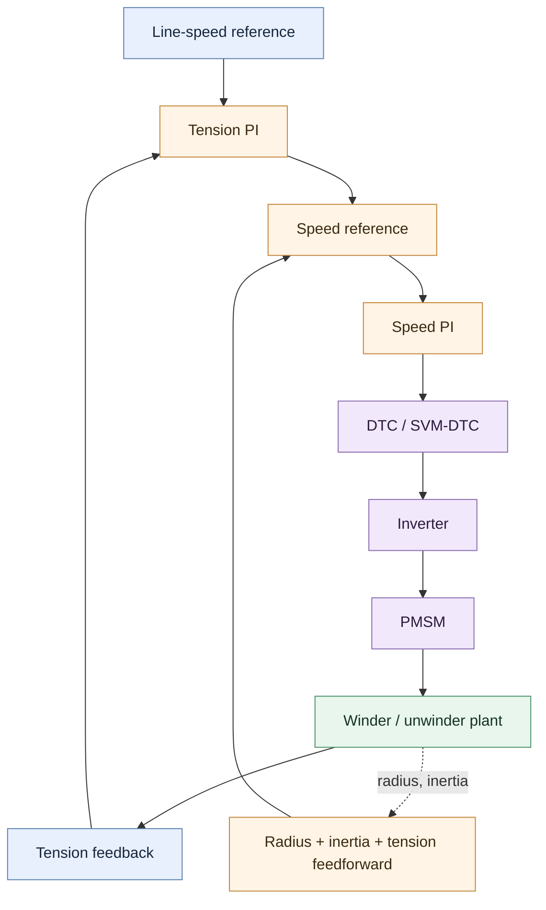
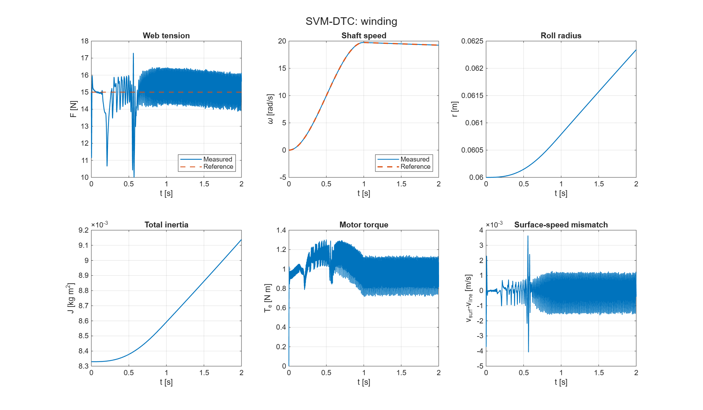
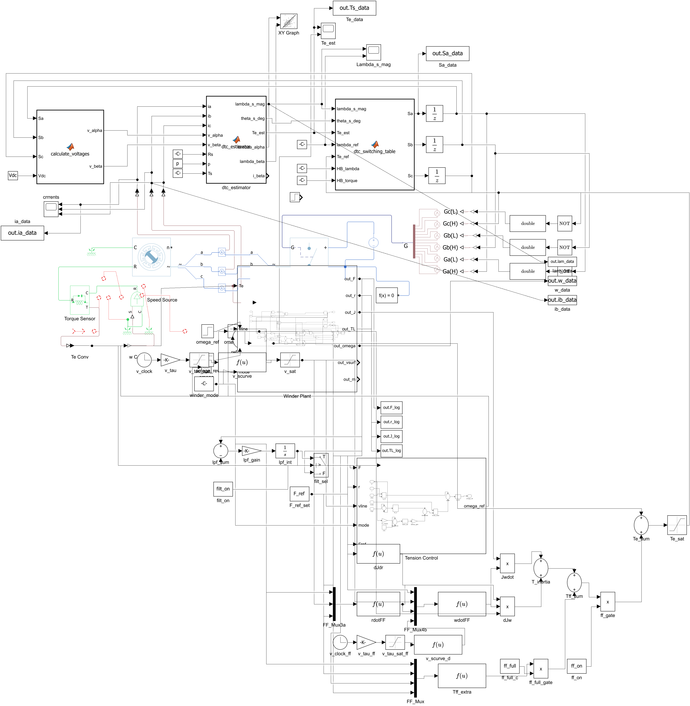

# ⚡ PMSM DTC / SVM-DTC Winder Simulation

<p align="center">
  <b>Classical DTC vs SVM-DTC for a PMSM-driven winder/unwinder with tension control</b>
</p>

<p align="center">
  
  
  
  
  
</p>

---

## Overview

This repository studies **Direct Torque Control (DTC)** of a surface-mounted PMSM and applies it to a **winder/unwinder** with a variable-radius roll, variable inertia, elastic web, tension loop, and feedforward compensation.

Two drive-level torque-control schemes are compared on **the same mechanical plant and the same outer tension loop**:

| Controller | Torque/flux actuation | Switching |
|---|---|---|
| **Classical DTC** | Hysteresis comparators + switching table | Variable switching frequency |
| **SVM-DTC** | Flux PI + torque PI + rotation + inverse Clarke | Fixed-frequency PWM (5 kHz) |



The project covers:

- PMSM modelling and voltage-model flux/torque estimation
- Classical hysteresis DTC and SVM-DTC
- Stator-resistance mismatch, low speed, and reversal robustness
- Winder/unwinder mechanics with radius and inertia variation
- Tension PI control, radius/inertia/tension feedforward, S-curve line reference
- Kelvin–Voigt viscoelastic web damping
- Full 18-case final comparison matrix

---

## Key results

Representative final results from the 2 s, damped-web, S-curve matrix:

| Case | F RMSE | F min | F max | Torque ripple | Phase-current peak |
|---|---:|---:|---:|---:|---:|
| SVM wind, FF off | 6.215 N | 0.00 | 22.72 | 0.075 N·m | 1.40 A |
| SVM wind, FF on | 0.772 N | 10.01 | 17.29 | 0.075 N·m | 1.22 A |
| Classical wind, FF off | 6.236 N | 0.00 | 22.06 | 0.420 N·m | 2.16 A |
| Classical wind, FF on | **0.267 N** | 14.03 | 15.92 | 0.420 N·m | 1.98 A |
| SVM unwind, FF on | **0.052 N** | 8.84 | 17.38 | 0.019 N·m | 1.72 A |
| Classical unwind, FF on | 0.100 N | 13.43 | 16.75 | 0.414 N·m | 2.55 A |

**Main observations**

- Feedforward reduces tension RMSE by **88–98 %** and removes startup slack.
- Classical DTC + FF gives the tightest tension band, but with about **5×** the torque ripple.
- SVM-DTC is smoother and draws lower peak current.
- No final case saturates the torque limit.
- The earlier “classical flux-estimator collapse” was traced to a **torque-reference wiring error**, not the estimator.

> Full discussion: [`experiments/exp05_winder_mechanics/README.md`](experiments/exp05_winder_mechanics/README.md)  
> Final report: [`reports/final_2026-11/main.pdf`](reports/final_2026-11/main.pdf)

### Waveform preview

<p align="center">
  
  
</p>

### Whole-model screenshots

<p align="center">
  
  
</p>

See all experiment models in [`docs/screenshots/`](docs/screenshots/README.md).

---

## Repository layout

```text
simulation/
├── README.md                     ← this file
├── LICENSE
├── CITATION.cff
├── .gitignore
├── docs/                         ← runbook, changelog, lessons, block audits, model screenshots
├── experiments/
│   ├── exp01_svm_vs_classic_dtc/ classical vs SVM-DTC: dynamic test + sweep
│   ├── exp02_robustness/         Rs mismatch, low speed, speed reversal
│   ├── exp03_rs_boundary/        fine Rs sweep: estimator stability boundary
│   └── exp05_winder_mechanics/   winder plant + both drives + tension loop
├── reports/
│   ├── midsem_2026-10/           mid-semester report
│   └── final_2026-11/            final report
├── tools/                        shared MATLAB helpers
└── templates/                    experiment README template
```

Each experiment follows the same structure:

```text
expNN_short_name/
├── models/       Simulink .slx models
├── scripts/      MATLAB run/analysis scripts
├── results/      metrics CSV and (locally) raw .mat results
├── figures/      PNG/PDF figures
└── README.md
```

> **Large files are intentionally not committed.** Raw `.mat` results and editable `.fig` files can be regenerated with the scripts below. This keeps the GitHub repository lightweight.

---

## Quick start

### Requirements

- **MATLAB R2026a** (or compatible)
- **Simulink**
- **Simscape**
- **Simscape Electrical**

Check once:

```matlab
ver Simulink
ver Simscape
ver Simscape_Electrical
```

### Run one winder case (≈2–4 min)

From the repository root:

```matlab
cd('experiments/exp05_winder_mechanics')

addpath(fullfile(pwd,'models'), fullfile(pwd,'scripts'), ...
        fullfile(pwd,'..','..','tools'))

run('..\exp03_rs_boundary\scripts\pmsm_dtc_parameters.m')
run('scripts\winder_params.m')

met = run_case_2s('classic_dtc_winder', +1, 0.06, 'my_test', 1, 1);
```

Outputs:

- `results/val2s_my_test.mat` — raw waveforms
- `figures/fig2s_my_test.png/.pdf/.fig` — six-panel figure
- Printed metrics in the MATLAB command window

`run_case_2s` arguments:

```matlab
run_case_2s(model, mode, r0, tag, ffon, fffull)
```

| Argument | Meaning |
|---|---|
| `model` | `'svm_dtc_winder'` or `'classic_dtc_winder'` |
| `mode` | `+1` winding, `-1` unwinding |
| `r0` | initial radius [m], e.g. `0.06` or `0.115` |
| `tag` | filename tag |
| `ffon` | `0` feedforward off, `1` on |
| `fffull` | `1` full feedforward, `0` inertia only |

### Run the full 18-case matrix (≈1 h)

```matlab
cd('experiments/exp05_winder_mechanics')
run('scripts\run_final_matrix.m')
```

Outputs:

- `results/final_matrix.csv`
- `results/final_matrix.mat`
- `results/val2s_<tag>.mat`
- `figures/fig2s_<tag>.png/.pdf/.fig`

### Reproduce exp01–exp03

```matlab
cd('experiments/exp01_svm_vs_classic_dtc')
setup_paths
run_all
make_results
```

Use the corresponding experiment folder for `exp02` and `exp03`. See each `README.md` for runtime and details.

---

## Experiments

| Experiment | Focus | Key output |
|---|---|---|
| [exp01](experiments/exp01_svm_vs_classic_dtc/README.md) | Classical DTC vs SVM-DTC: dynamic test + speed × load sweep | Torque ripple, THD, switching frequency |
| [exp02](experiments/exp02_robustness/README.md) | Rs mismatch, low speed, speed reversal | Flux error, loss-of-control flags |
| [exp03](experiments/exp03_rs_boundary/README.md) | Fine Rs sweep at 20 and 5 rad/s | Stability boundary and failure time |
| [exp05](experiments/exp05_winder_mechanics/README.md) | Winder/unwinder + tension loop + feedforward | Full 18-case final matrix |

---

## Documentation

| Document | Purpose |
|---|---|
| [`docs/RUNBOOK.md`](docs/RUNBOOK.md) | Manual operation, parameters, outputs, troubleshooting |
| [`docs/CHANGELOG.md`](docs/CHANGELOG.md) | Research log and decisions |
| [`docs/lessons_learned.md`](docs/lessons_learned.md) | Debugging knowledge |
| [`docs/FILE_MAP.md`](docs/FILE_MAP.md) | Where old files were moved |
| [`docs/BLOCK_AUDIT_classic_clean.md`](docs/BLOCK_AUDIT_classic_clean.md) | Block-by-block audit of the classical winder model |

---

## Model notes

- **Flux estimator:** voltage model, forward Euler, with measured currents and reconstructed inverter voltage.
- **Classical DTC:** 2-level flux hysteresis, 3-level torque hysteresis, switching table.
- **SVM-DTC:** flux/torque PIs in the stator-flux frame, rotation by estimated flux angle, inverse Clarke, 5 kHz PWM.
- **Speed loop:** PI with clamping anti-windup.
- **Winder:** momentum-form variable-inertia roll model, Kelvin–Voigt web, S-curve line reference.
- **Tension loop:** PI speed trim + radius/inertia/tension feedforward.

Known limitations are documented in [`experiments/exp05_winder_mechanics/README.md`](experiments/exp05_winder_mechanics/README.md) §21.4.

---

## Citation

If you use this work, please cite:

```bibtex
@software{pmsmdtc2026,
  author  = {{PMSM DTC/SVM-DTC Winder Simulation contributors}},
  title   = {PMSM DTC/SVM-DTC Winder Simulation},
  year    = {2026},
  version = {1.0.0}
}
```

A machine-readable [`CITATION.cff`](CITATION.cff) is included.

---

## License

Released under the **MIT License**. See [`LICENSE`](LICENSE).

---

## Project notes

This repository is intended as a reproducible simulation study. The written report in
[`reports/final_2026-11/`](reports/final_2026-11/) contains the academic submission details.
