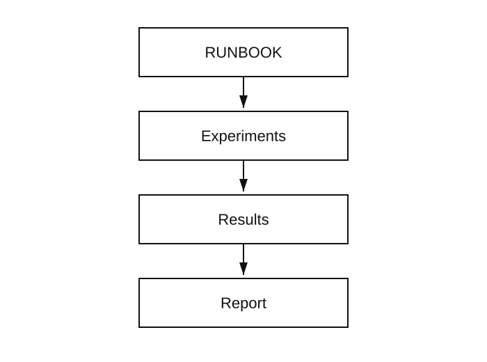

# Documentation index

`docs/` holds the operating manual, the research log, and the reference notes for this
simulation repository. Start with the runbook; use the rest when you need history,
debugging context, or model details.

## How the documents fit together

  

The runbook drives the experiments, the experiments produce results, and the results
become the report. The research log and lessons learned are reviewed afterwards to decide
what to do next.

## Core documents

| File | What it is for |
|---|---|
| [RUNBOOK.md](RUNBOOK.md) | Step-by-step instructions: prerequisites, rebuilding the PDFs, running the simulations, and what each folder contains. |
| [RESEARCH_LOG.md](RESEARCH_LOG.md) | Dated research log: what was built, what broke, and what was fixed. |
| [LESSONS_LEARNED.md](LESSONS_LEARNED.md) | Numbered debugging lessons — the mistakes worth not repeating. |
| [PROJECT_HISTORY.md](PROJECT_HISTORY.md) | Short history note: the public repo keeps the final project, not the old development snapshots. |
| [literature_rs_robust_flux_estimation.md](literature_rs_robust_flux_estimation.md) | First-pass literature map on flux estimation that tolerates a wrong stator resistance, including candidate gaps. |

## Model screenshots

- [Model screenshots](screenshots/README.md) — full top-level views of the canonical Simulink models in exp01–exp05.

## Model audit

The audit records what is inside the main clean winder model, so a parameter can be
checked without opening every block. The evidence files are grouped in `model_audit/`.

| File | What it contains |
|---|---|
| [model_audit/README.md](model_audit/README.md) | Human-readable audit: block counts, key parameters, and warnings about which model file is actually used. |
| [model_audit/classic_dtc_winder_clean_important_params.csv](model_audit/classic_dtc_winder_clean_important_params.csv) | Short curated list of the parameters that actually change behaviour. |
| [model_audit/classic_dtc_winder_clean_key_values.csv](model_audit/classic_dtc_winder_clean_key_values.csv) | Key block values shown as both the expression and the resolved number. |
| [model_audit/classic_dtc_winder_clean_all_params.csv](model_audit/classic_dtc_winder_clean_all_params.csv) | Every dialog parameter of the user-level blocks, including defaults. |
| [model_audit/classic_dtc_winder_clean_all_blocks.csv](model_audit/classic_dtc_winder_clean_all_blocks.csv) | Every block path in the audited model, including standard library internals. |
| [model_audit/classic_dtc_winder_clean_matlab_functions.txt](model_audit/classic_dtc_winder_clean_matlab_functions.txt) | Full source of the MATLAB Function blocks and the `dtc_estimator` chart. |

## Suggested reading order

1. [RUNBOOK.md](RUNBOOK.md) — how to run and rebuild the project.
2. [RESEARCH_LOG.md](RESEARCH_LOG.md) — how the work developed.
3. [LESSONS_LEARNED.md](LESSONS_LEARNED.md) — known debugging traps.
4. [PROJECT_HISTORY.md](PROJECT_HISTORY.md) — what the public snapshot includes and excludes.
5. [literature_rs_robust_flux_estimation.md](literature_rs_robust_flux_estimation.md) — literature map for flux-estimator robustness.
6. [model_audit/README.md](model_audit/README.md) — block-level model audit.
7. [screenshots/README.md](screenshots/README.md) — full-model screenshots.
