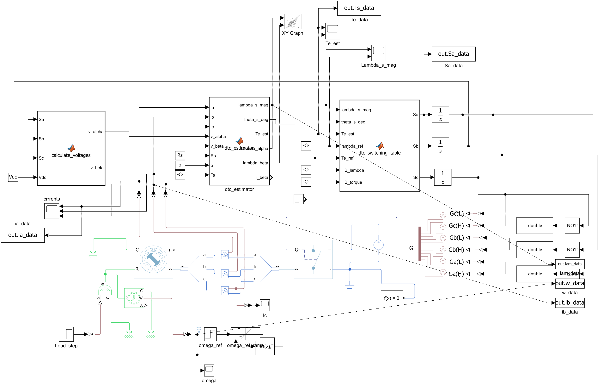
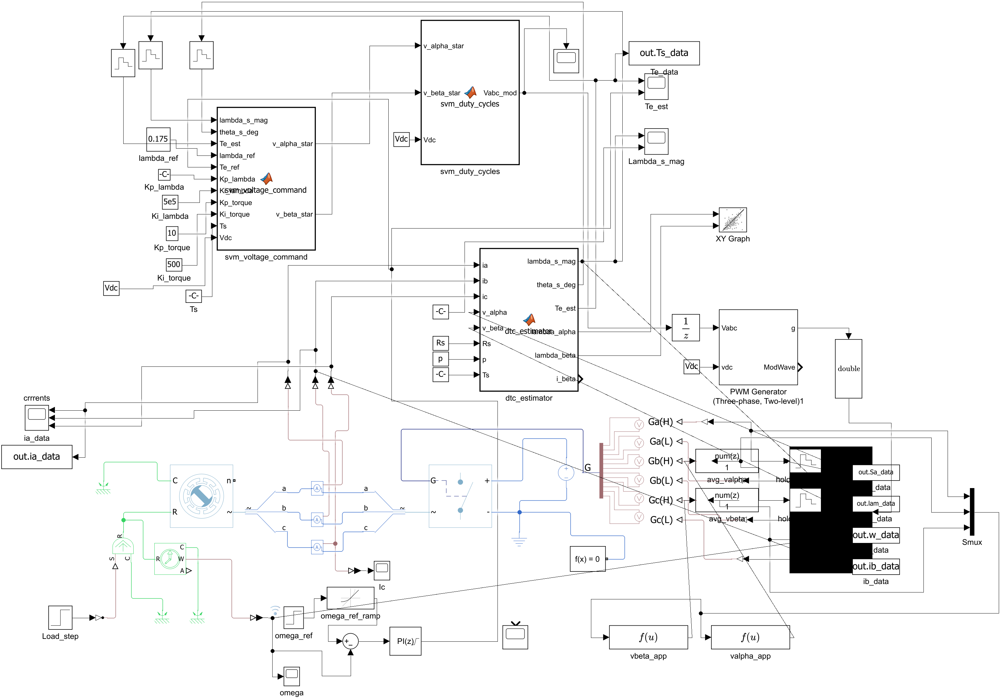
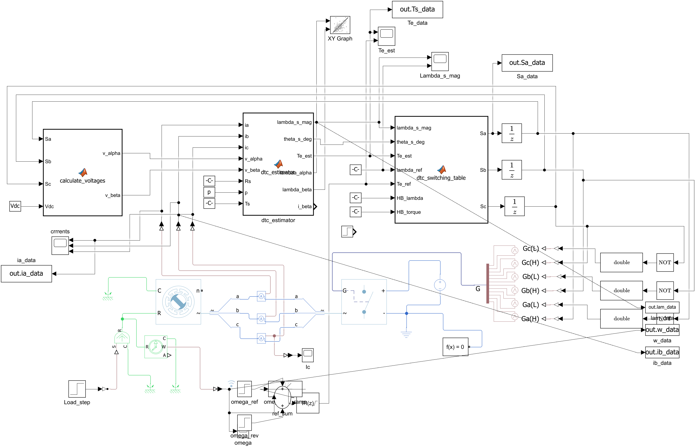
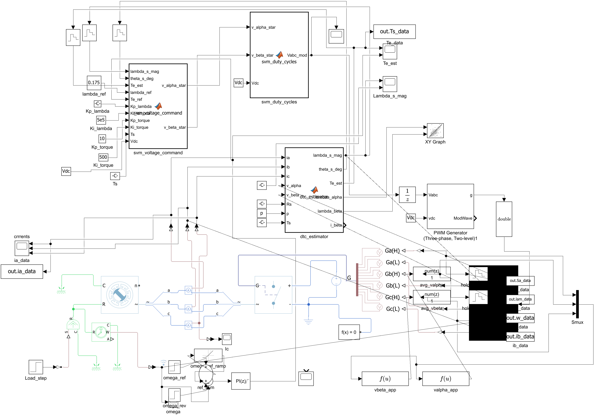
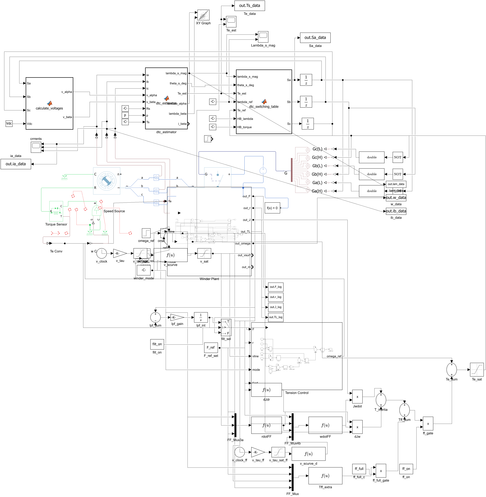
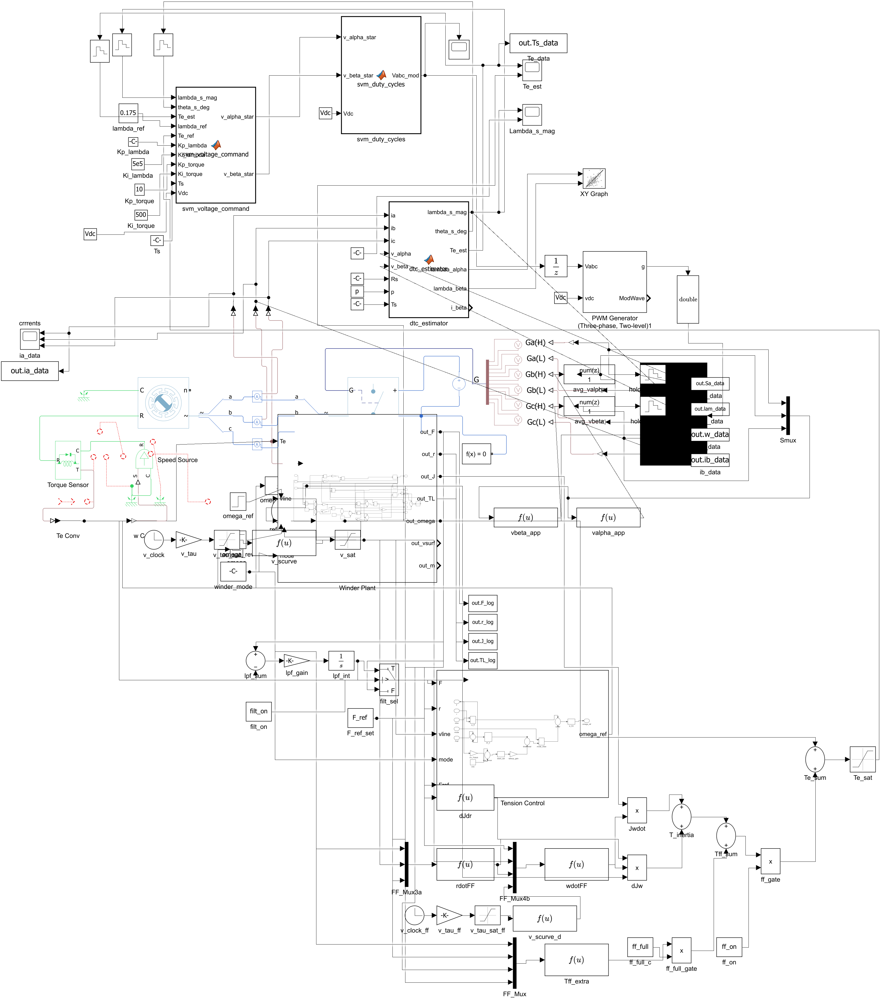
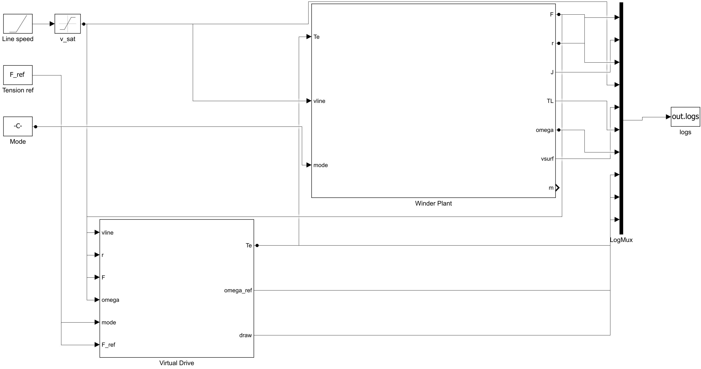

# Model screenshots

These are top-level screenshots of the canonical Simulink models used in the experiments.
They show the complete model, not a subsystem or a cropped view. Readability copies
(`*_clean.slx`) are not included; unused intermediate wrappers were removed.

Note: exp02 and exp03 reuse the same drive model; only the test matrix differs, so
their model screenshots are intentionally identical.

| Experiment | Model | Screenshot |
|---|---|---|
| exp01 | Classical DTC |  |
| exp01 | SVM-DTC |  |
| exp02 | Classical DTC, Rs robustness |  |
| exp02 | SVM-DTC, Rs robustness |  |
| exp03 | Classical DTC, Rs boundary |  |
| exp03 | SVM-DTC, Rs boundary |  |
| exp05 | Classical DTC winder |  |
| exp05 | SVM-DTC winder |  |
| exp05 | Winder plant only |  |

## What you are looking at

- **exp01–exp03**: the PMSM, inverter, sensors, flux estimator, DTC or SVM-DTC
  controller, speed loop, load, and logging blocks.
- **exp05**: the same drive plus the winder/unwinder plant, tension loop,
  line-speed reference, feedforward, and logging.
- **exp05_winder_plant**: the standalone mechanical plant used for validation.

## Regenerate them

From the repository root in MATLAB:

```matlab
addpath('tools')
export_model_screenshots
```

Outputs are written to `docs/screenshots/`.
