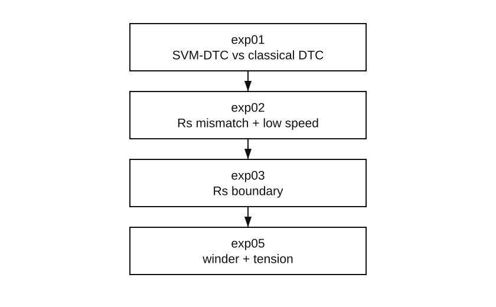

# Experiments

Each folder contains one study with its own `models/`, `scripts/`, `results/`,
`figures/`, and `README.md`. The folder numbers indicate development order, not the
number of folders.

## Sequence

1. **exp01** compares classical hysteresis DTC and SVM-DTC under identical motor,
   load, and test conditions.
2. **exp02** tests the shared flux estimator with a mismatched stator resistance,
   at low speed, and through a speed reversal.
3. **exp03** resolves the Rs-error stability boundary in 5–10 % steps.
4. **exp05** applies the drives to a winder/unwinder plant with a tension loop and
   feedforward, then runs the final 18-case matrix.

## Dependencies

| Experiment | Depends on | Reason |
|---|---|---|
| exp01 | — | Standalone drive comparison |
| exp02 | exp01 model structure | Adds estimator-Rs and reversal hooks |
| exp03 | exp02 baseline results | Reuses the 70/100/130 % cases in its boundary table |
| exp05 | exp03 models and `pmsm_dtc_parameters.m` | Reuses the validated drive model |

## Experiment index

| Folder | Purpose | README |
|---|---|---|
| `exp01_svm_vs_classic_dtc` | Classical DTC vs SVM-DTC: dynamic test and speed × load sweep | [exp01 README](exp01_svm_vs_classic_dtc/README.md) |
| `exp02_robustness` | Rs mismatch, low speed, and speed reversal | [exp02 README](exp02_robustness/README.md) |
| `exp03_rs_boundary` | Fine Rs sweep at 20 and 5 rad/s | [exp03 README](exp03_rs_boundary/README.md) |
| `exp05_winder_mechanics` | Winder/unwinder plant, tension loop, feedforward, final matrix | [exp05 README](exp05_winder_mechanics/README.md) |

## Result naming

- exp01 tags: `cl_dyn`, `svm_dyn`, `cl_w10_T0.5`, ...
- exp02 tags: `cl_mid_rs070`, `svm_low_w5_rs130`, ...
- exp03 tags: `cl_w20_rs080`, `svm_w5_rs105`, ...
- `cl` means classical DTC; `svm` means SVM-DTC.
- `rs070` means 70 % of the true stator resistance.

The CSV schemas differ slightly between experiments; use each folder's
`results/metrics_summary.csv` header as the authoritative column list.

exp04 was not used; the numbering follows the research log.

For commands, see the [runbook](../docs/RUNBOOK.md). For model screenshots, see
[screenshots](../docs/screenshots/README.md).
