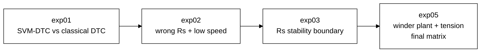

# Experiments

Each folder is one self-contained study with its own `models/`, `scripts/`,
`results/`, `figures/`, and `README.md`. The numbers show the order the work was done,
not a count of folders.

## The sequence

In plain language:

1. **exp01** establishes the comparison: run classical DTC and SVM-DTC on the same
   motor, the same tests, and the same metrics.
2. **exp02** stress-tests the shared flux estimator by giving it a wrong stator
   resistance, then pushes the drives to low speed and through a reversal.
3. **exp03** zooms in on that weakness with a finer Rs sweep to find the exact
   stability boundary.
4. **exp05** puts the drive on a realistic winder/unwinder plant with a tension loop
   and feedforward, then runs the final comparison matrix.

## Experiment index

| Folder | Purpose in one line | README |
|---|---|---|
| `exp01_svm_vs_classic_dtc` | Compares classical hysteresis DTC with SVM-DTC on identical dynamic and sweep tests. | [Open](exp01_svm_vs_classic_dtc/README.md) |
| `exp02_robustness` | Tests both drives with a mismatched stator resistance, at low speed, and during speed reversal. | [Open](exp02_robustness/README.md) |
| `exp03_rs_boundary` | Finds the Rs-error stability boundary at 20 and 5 rad/s and checks the proposed error-growth explanation. | [Open](exp03_rs_boundary/README.md) |
| `exp05_winder_mechanics` | Adds the winder/unwinder plant, tension control, and feedforward; contains the main final results. | [Open](exp05_winder_mechanics/README.md) |

> [!NOTE]
> **There is no exp04.** The numbering intentionally jumps from `exp03` to `exp05`.
> This is not a missing folder or a broken link — use the numbers as labels, not as a
> folder count.

For the commands that run these experiments and rebuild their figures, see the
[runbook](../docs/RUNBOOK.md). For full top-level model views, see
[model screenshots](../docs/screenshots/README.md).
