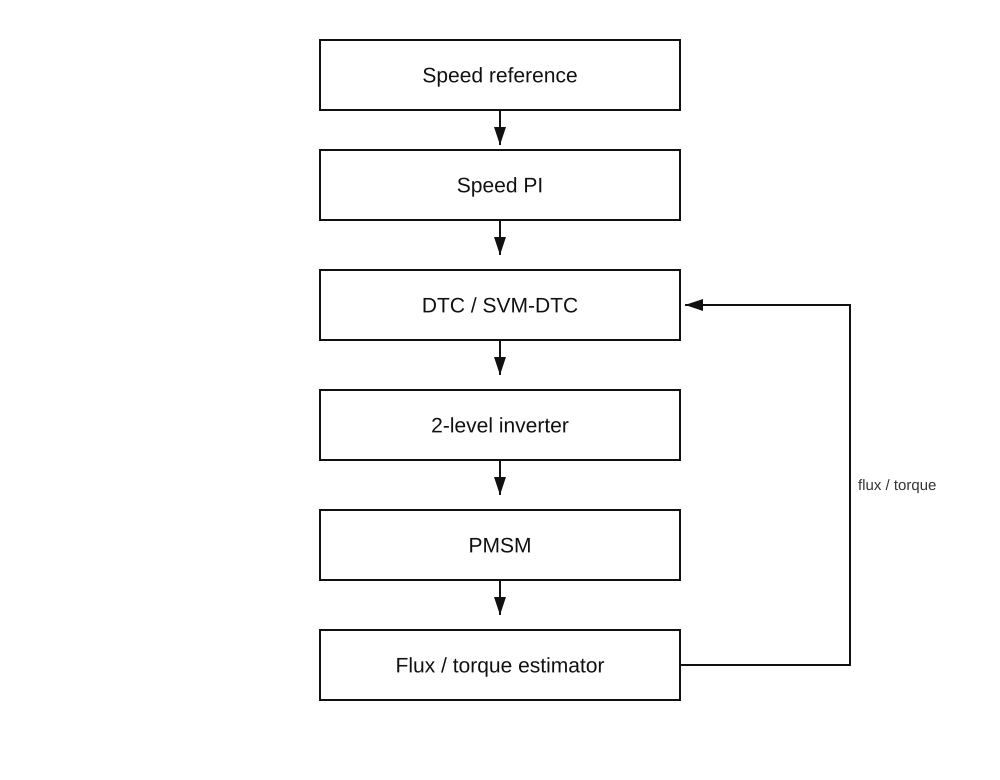
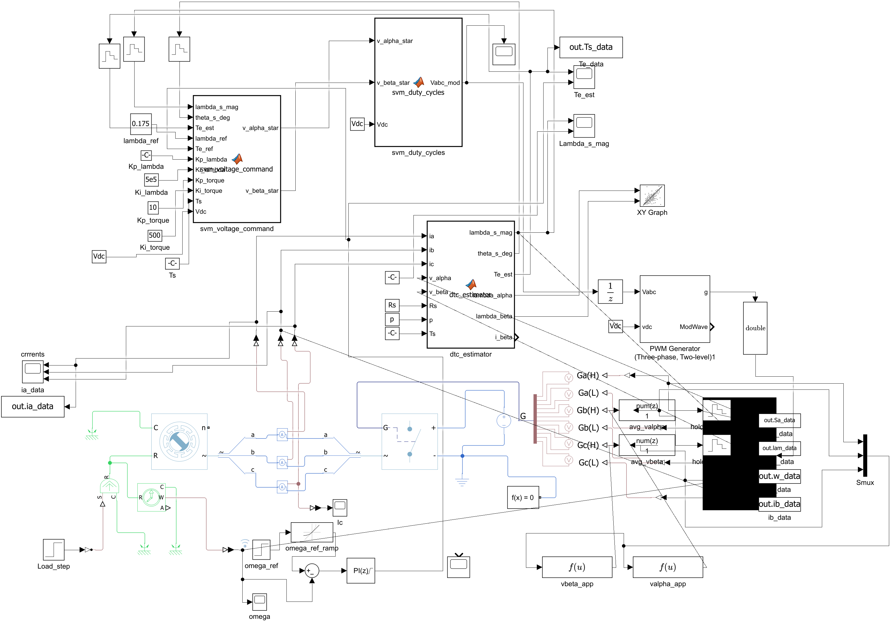
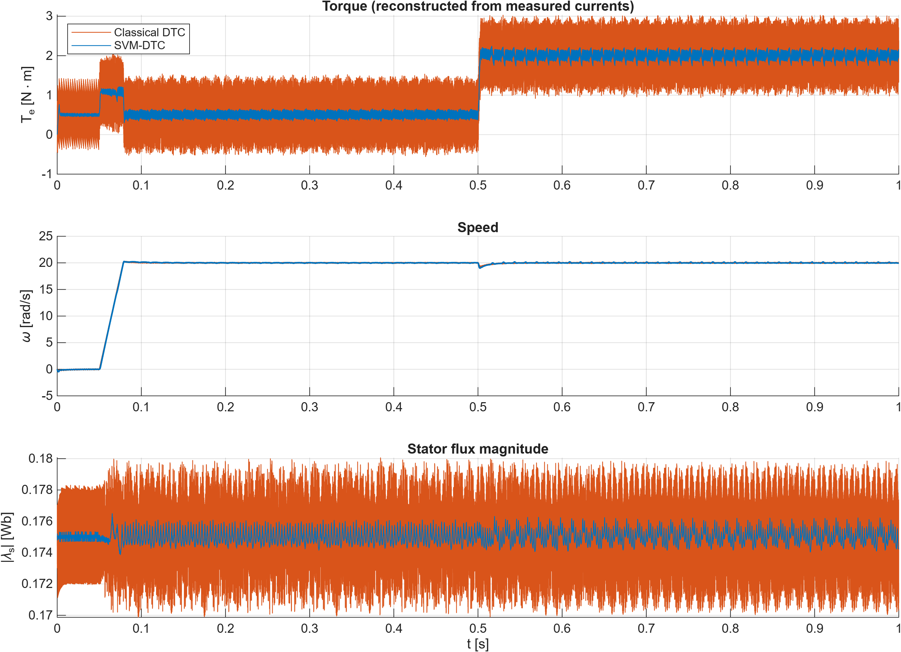
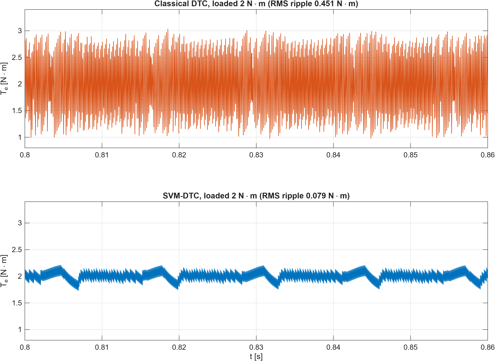

# Experiment 01 — SVM-DTC vs classical DTC

Comparison of classical hysteresis-based direct torque control (DTC) and space-vector-modulated DTC (SVM-DTC) on the same surface-mounted PMSM. Both controllers use the same speed PI, flux estimator, and 20 µs control period.

## Summary

| Item | Detail |
|---|---|
| **Question** | How much smoother is SVM-DTC than classical DTC, and what does it cost in speed dynamics? |
| **Plant** | Surface-mounted PMSM: Rs = 2.875 Ω; Ld = Lq = 8.5 mH; λf = 0.175 Wb; 4 pole pairs |
| **Controllers** | Classical DTC: hysteresis + switching table. SVM-DTC: torque/flux PI + space-vector modulation at 5 kHz |
| **Tests** | 1 dynamic test (0 → 20 rad/s, 0.5 → 2 N·m) + a 6-point speed × load sweep |
| **Runs** | 14 simulations: 7 per controller |
| **Runtime** | ≈3 h in one session (machine-dependent); ≈1.5 h per controller with two sessions |
| **Main result** | Torque ripple 3.5–13× lower at 0.5 N·m and 3–6.5× lower at 4 N·m; flux ripple 3–7× lower; speed dynamics are close |
| **Software** | MATLAB R2026a (or compatible), Simulink, Simscape, Simscape Electrical |
| **Outputs** | `results/metrics_summary.csv`, 9 figures, one `.mat` per case |

Torque ripple produces vibration, acoustic noise, and current harmonics, so lower ripple is a drive-quality gain. Classical DTC is simple and fast but produces a coarse voltage waveform; SVM-DTC adds computation to synthesize a smoother average voltage. This experiment quantifies that trade-off and provides the nominal-parameter baseline for the Rs-error tests in exp02 and exp03.

## Nomenclature

| Symbol / term | Definition | Unit |
|---|---|---|
| **PMSM** | Surface-mounted permanent-magnet synchronous motor | — |
| **DTC** | Direct torque control; inverter states selected from torque and flux hysteresis outputs | — |
| **SVM** | Space-vector modulation; average voltage synthesized from the inverter's discrete states | — |
| **Rs** | Stator resistance, 2.875 Ω | Ω |
| **Ld, Lq** | Stator inductances, 8.5 mH each | mH |
| **λf** | Permanent-magnet flux linkage, 0.175 Wb | Wb |
| **p** | Pole pairs, 4 | — |
| **Te** | Electromagnetic torque, reconstructed as 1.5 p λf iq | N·m |
| **ω** | Angular speed | rad/s |
| **Torque ripple** | RMS or peak-to-peak deviation of Te from its mean | N·m |
| **THD** | Total harmonic distortion of phase current, harmonics up to 20 kHz | % |

## Signal flow



*Figure 1. Signal flow for the two controllers. Both share the speed PI, flux estimator, and 20 µs control period.*

The two controllers receive the same torque command:

- **Classical DTC** sends the torque and flux errors to hysteresis comparators; a switching table selects one of the inverter's active vectors. The switching frequency is not fixed.
- **SVM-DTC** sends the errors to PI regulators, constructs a voltage reference, and modulates it with a 5 kHz carrier. The switching frequency is fixed.

Both controllers use the same 20 µs control period and the same speed PI.

## Whole-model screenshots


*Figure 2a. Classical DTC top-level model.*



*Figure 2b. SVM-DTC top-level model.*

Both are complete top-level models: PMSM, inverter, sensors, estimator, controller, speed loop, load, and logging.

## Test plan

| Test | Speed | Load | Analysis windows | What it checks |
|---|---|---|---|---|
| Dynamic | 0 → 20 rad/s (700 rad/s² ramp from 0.05 s) | 0.5 → 2 N·m at 0.5 s | 0.3–0.5 s, 0.7–1.0 s | startup, load step, settling |
| Sweep | 10 / 30 / 60 rad/s | 0.5 and 4 N·m (step at 0.3 s) | 0.5–0.9 s | steady-state ripple at six operating points |

Fixed conditions:

- DC bus 300 V; flux reference 0.175 Wb.
- Classical hysteresis: flux band 1% of reference (1.75 mWb), torque band 0.02 N·m.
- Speed PI: P = 2, I = 150, clamping anti-windup.
- SVM carrier: 5 kHz, 2 µs time resolution (`Ts_pwm`).
- The flux estimator uses the gate-pulse voltage averaged over each 20 µs control period, not the commanded voltage.

## What is measured

| Metric | How it is computed | Unit |
|---|---|---|
| **True torque ripple** | RMS and pk-pk of `Te = 1.5 p λf iq`, reconstructed from measured currents and rotor angle | N·m |
| **Flux ripple** | pk-pk and RMS of the estimated stator-flux magnitude | Wb |
| **Current THD** | FFT of phase-A current, up to 20 kHz | % |
| **Switching frequency** | Phase-A transitions / (2 × window length) | Hz |
| **Dynamics** | Speed overshoot, 1% settling time, load dip, recovery time, torque rise 10–90% | %, ms, rad/s |

The "true" torque is independent of the controller's own torque estimate. The estimated torque is also logged, but the comparison uses true torque.

## How to run

From the repository root:

```matlab
cd('experiments/exp01_svm_vs_classic_dtc')
setup_paths
run_all          % 14 simulations, about 3 h
make_results     % tables + 9 figures + results/metrics_summary.csv
```

`setup_paths` adds `models/`, `scripts/` and the shared `tools/` folder to the MATLAB path, and sends Simulink's generated cache to a temp folder.

To use two MATLAB sessions:

```matlab
sel = 1; run_all   % SVM-DTC only
sel = 2; run_all   % classical DTC only
```

`run_all` resumes: a case whose `results/result_*.mat` already exists is skipped. Delete those files to force a rerun.

## Files and outputs

```text
exp01_svm_vs_classic_dtc/
├── models/    svm_dtc_final.slx, classic_dtc_final.slx
├── scripts/   pmsm_dtc_parameters.m, dtc_metrics.m, run_case.m,
│              run_all.m, make_results.m, build_final_models_historical.m
├── results/   result_<tag>.mat (14), metrics_summary.csv
└── figures/   fig01 ... fig09  (PNG + PDF + FIG)
```

| Output | What it contains |
|---|---|
| `results/result_<tag>.mat` | Raw waveforms and metrics for one case. |
| `results/metrics_summary.csv` | 16 rows (one per analysis window) with torque, flux, THD, switching frequency and speed. |
| `figures/fig01–fig03` | Dynamic test: overview, loaded torque zoom, load-step response. |
| `figures/fig04–fig05` | Phase-A current waveform and spectrum. |
| `figures/fig06–fig09` | Sweep bars: torque ripple, THD, flux ripple, switching frequency. |

`build_final_models_historical.m` documents how the two final models were derived; it is not needed for reproduction.

A fresh clone may not include the large `.mat` or `.fig` files; regenerate them with `run_all` and `make_results`.

## Key results

### Torque ripple

| Operating point | Classical DTC | SVM-DTC | SVM advantage |
|---|---:|---:|---:|
| Dynamic, 0.5 N·m | 0.445 N·m | 0.055 N·m | 8× lower |
| Dynamic, 2 N·m | 0.451 N·m | 0.079 N·m | 5.7× lower |
| Sweep, 0.5 N·m | 0.446–0.461 N·m | 0.036–0.126 N·m | 3.5–13× lower |
| Sweep, 4 N·m | 0.437–0.451 N·m | 0.069–0.153 N·m | 3–6.5× lower |

All values are RMS of the true torque. At 2 N·m the peak-to-peak ripple is 2.09 N·m for classical DTC and 0.48 N·m for SVM-DTC. As a fraction of the mean torque, the loaded dynamic case is 22.5% vs 3.9%.

### Other metrics

| Metric | Classical DTC | SVM-DTC |
|---|---|---|
| Flux ripple, pk-pk | ≈0.010 Wb | 0.0014–0.0032 Wb |
| Current THD to 20 kHz, 4 N·m | 12.7–13.1% | 2.5–4.1% |
| Switching frequency | 7.08–7.63 kHz (variable) | 5 kHz (fixed) |
| Speed overshoot | 1.18% | 1.37% |
| 1% settling time | 33.2 ms | 41.8 ms |
| Load dip at 2 N·m step | 0.723 rad/s | 0.988 rad/s |
| Recovery after load step | 21.0 ms | 20.7 ms |
| Torque rise, 10–90% | 2.52 ms | 1.86 ms |

SVM-DTC has lower torque ripple and current distortion. The speed loop is the same PI for both controllers and was not retuned, so the differences in overshoot, settling time, and load dip are indicative rather than a controller ranking. SVM-DTC raises torque faster (1.86 ms vs 2.52 ms).

THD is load-dependent: at 0.5 N·m the fundamental current is small, so both controllers show high THD (classical ≈104%, SVM 14–25%). Compare THD at the same load, not across loads.

### Figures



*Figure 3. Dynamic test: torque, speed and stator flux. The load step at 0.5 s is visible in all three traces.*



*Figure 4. True torque at 2 N·m. Classical DTC (top) swings about ±1 N·m; SVM-DTC (bottom) stays in a narrow band.*


*Figure 5. True torque ripple RMS at all six sweep points. SVM-DTC is lower everywhere, but the gap narrows at high speed and high load.*

## Limitations

- **Ideal inverter:** no dead time; diode forward drop is modelled as 0.8 V.
- **Simple flux estimator:** pure voltage-model integrator with no drift compensation. It is accurate here but will drift at very low speed or with Rs error — the subject of exp02 and exp03.
- **Current sign:** the current sensors are inverted in the Simscape setup; the estimator and metrics apply a −1 sign (`cfg.current_sign`).
- **SPMSM assumption:** torque is reconstructed with `Te = 1.5 p λf iq`, valid because Ld = Lq.
- **One operating envelope:** one motor, one DC bus, one speed-loop tuning; no hardware validation.
- **Fixed carrier:** the SVM carrier is 5 kHz. A different carrier frequency would change the ripple/THD trade-off.
- **THD caveat:** light-load THD is relative to a small fundamental, so it is not a fair "efficiency" number.

## References

Reference list and BibTeX keys: [refs.bib](../../reports/final_2026-11/refs.bib).

- Takahashi, I., & Noguchi, T. (1986). A new quick-response and high-efficiency control strategy of an induction motor. *IEEE Trans. Ind. Appl.* Key: `takahashi1986`.
- Depenbrock, M. (1988). Direct self-control (DSC) of inverter-fed induction machine. *IEEE Trans. Power Electron.* Key: `depenbrock1988`.
- Zhong, L., Rahman, M. F., Hu, W. Y., & Lim, K. W. (1997). Analysis of direct torque control in permanent magnet synchronous motor drives. *IEEE Trans. Power Electron.* Key: `zhong1997`.
- Buja, G. S., & Kazmierkowski, M. P. (2004). Direct torque control of PWM inverter-fed AC motors — a survey. *IEEE Trans. Ind. Electron.* Key: `buja2004`.

Next: [Experiment 02 — robustness to Rs error](../exp02_robustness/README.md)
