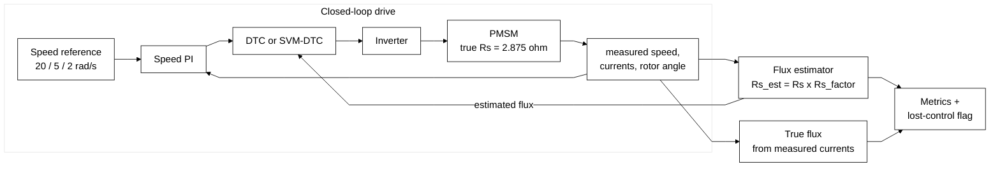
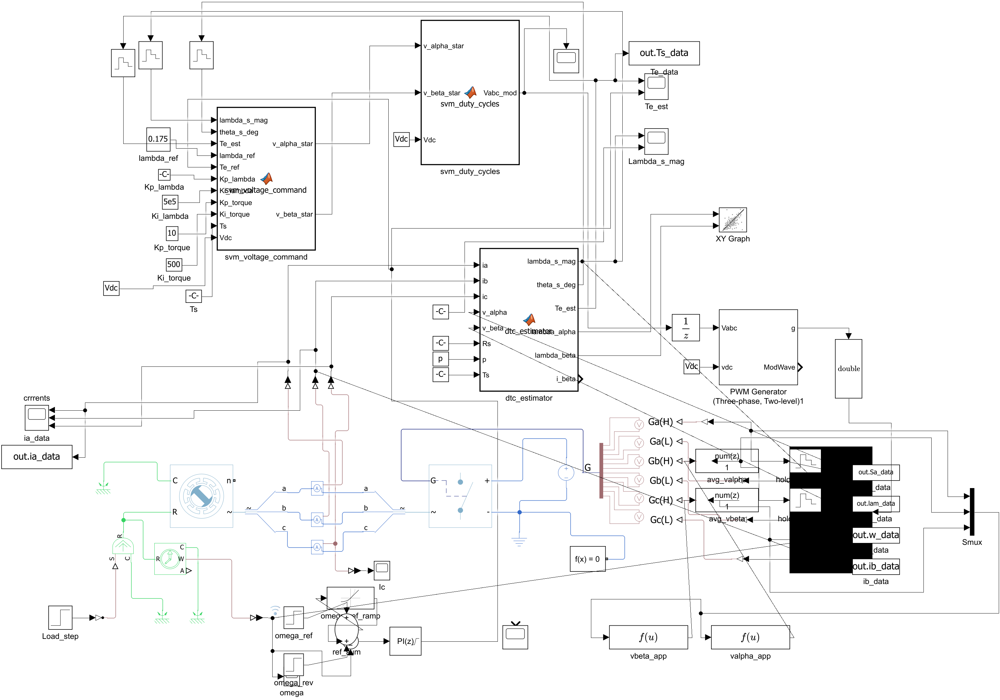
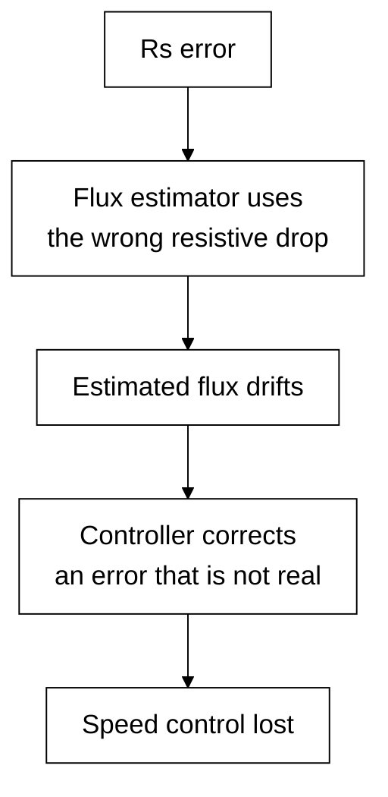
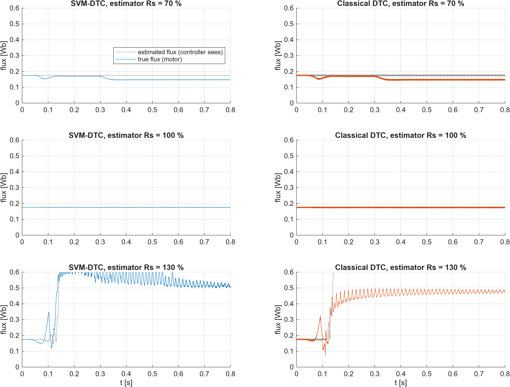

# Experiment 02 — Robustness to stator-resistance error

**Both controllers share one weak point: the flux estimator.**

## At a glance

| | |
|---|---|
| **Question** | Do the controllers survive when the flux estimator uses the wrong stator resistance, especially at low speed and through a reversal? |
| **What is varied** | Estimator Rs = 70%, 100%, 130% of the true 2.875 Ω; speeds 20, 5, 2 rad/s; one +5 → −5 rad/s reversal |
| **Controllers** | SVM-DTC and classical DTC, with two added hooks: estimator Rs multiplier and speed reversal |
| **Runs** | 20 simulations: 10 per controller |
| **Runtime** | ≈1 h per controller (machine-dependent); ≈2 h total |
| **Main result** | Both controllers fail in the same 5 of 9 Rs-mismatch cases; +30% fails at every speed, −30% only at low speed |
| **Software** | MATLAB R2026a (or compatible), Simulink, Simscape, Simscape Electrical |
| **Outputs** | 6 figures, `results/metrics_summary.csv`, 20 `.mat` files |

## Why it matters

- Copper resistance changes with temperature by tens of percent. A real controller will not know Rs exactly.
- A drive that only works with perfect parameters is not useful. The question is how much error it tolerates and how it fails.
- The failure mode matters: a wrong flux estimate can be silent (a bias) or violent (a runaway).

## Words you need

| Term | Plain meaning |
|---|---|
| **Rs** | Stator resistance — the copper resistance of the motor windings. True value here: 2.875 Ω. |
| **Flux** | Magnetic strength in the stator. The controller needs it to control torque. |
| **Wb** | Weber — the unit of magnetic flux. Nominal value here: 0.175 Wb. |
| **Flux estimator** | The controller's calculation of magnetic flux from voltage and current. There is no flux sensor. |
| **Rs_factor** | The multiplier used by the estimator: 0.7 = thinks Rs is 30% low; 1.3 = thinks it is 30% high. |
| **True flux** | Flux reconstructed from measured currents and rotor angle; used only for scoring, never by the controller. |
| **rad/s** | Angular speed. 2π rad/s ≈ one revolution per second. |
| **Lost control** | True flux drops below 50% of 0.175 Wb (0.0875 Wb), or mean speed error exceeds 20% of the target. |

## The one idea: a fuel gauge for flux

The estimator integrates the motor voltage minus the resistive drop:

```text
estimated flux = integral of (v - Rs_est * i)
```

If `Rs_est` is wrong, the subtracted drop is wrong, and the flux estimate drifts. A small error can stay hidden as a bias; a large error can feed on itself.

## How Rs error enters the drive



**Only the estimator changes.** The motor model always uses the true Rs = 2.875 Ω. The estimator uses `Rs_est = Rs × Rs_factor`.

| Estimator Rs | What it subtracts | What happens at 20 rad/s |
|---|---|---|
| **70%** | Too little resistive drop | Keeps control, but true flux settles at 0.147 Wb instead of 0.175 (−16%). The controller still believes 0.175. |
| **100%** | Correct drop | True flux 0.175 Wb. |
| **130%** | Too much resistive drop | The estimate runs away; true flux rises to 0.47–0.53 Wb and speed control is lost. |

## Whole-model screenshots

<p align="center">
  
  
</p>

Both models are the exp01 drives with two added hooks: an estimator Rs multiplier and a speed-reversal reference.

## The boundary found here



**In words:** at 20 rad/s the drive tolerates a 30% underestimate but not a 30% overestimate. At 5 and 2 rad/s it tolerates only the correct value. This is a coarse boundary; exp03 resolves it in smaller steps.

## Test matrix

| Set | Speed | Estimator Rs | Load | Analysis window | Cases per controller |
|---|---|---|---|---|---|
| 1. Medium | 20 rad/s | 70 / 100 / 130% | 0.5 → 2 N·m at 0.3 s | 0.5–0.8 s | 3 |
| 2. Low | 5 and 2 rad/s | 70 / 100 / 130% | 0.5 → 2 N·m at 0.3 s | 0.5–0.9 s | 6 |
| 3. Reversal | +5 → −5 rad/s at 0.6 s | 100% | 0.5 → 1 N·m at 0.2 s | 0.4–0.6 s and 0.9–1.2 s | 1 |

Total: 20 simulations (10 per controller). Controller sample time is 20 µs, same as exp01.

## How to run

From the repository root:

```matlab
cd('experiments/exp02_robustness')
setup_paths
sel = 1; run_all   % SVM-DTC, about 1 h
sel = 2; run_all   % classical DTC, about 1 h
make_results       % 6 figures + results/metrics_summary.csv
```

Run the two `sel` lines in separate MATLAB sessions if RAM allows; otherwise call `run_all` once and wait. Existing `results/result_*.mat` files are skipped, so interrupted runs resume.

`setup_paths` adds `models/`, `scripts/` and the shared `tools/` folder to the MATLAB path, and sends Simulink's generated cache to a temp folder.

## Files and outputs

```text
exp02_robustness/
├── models/    svm_dtc_rob.slx, classic_dtc_rob.slx
├── scripts/   pmsm_dtc_parameters.m, dtc_metrics.m, run_case.m,
│              run_all.m, make_results.m, build_robustness.m
├── results/   result_<tag>.mat (20), metrics_summary.csv
└── figures/   fig01 ... fig06  (PNG + PDF)
```

| Output | What it contains |
|---|---|
| `results/metrics_summary.csv` | 22 rows: 9 cases per controller plus the forward and reverse windows of the reversal. |
| `figures/fig01` | Estimated vs true flux at 20 rad/s for 70/100/130%. |
| `figures/fig02–fig04` | Speed responses at 20, 5 and 2 rad/s. |
| `figures/fig05` | Pass/fail map for all 9 Rs-mismatch cases. |
| `figures/fig06` | Speed and torque during the +5 → −5 rad/s reversal. |

`build_robustness.m` documents the two hooks added to the models; it is not needed for reproduction.

A fresh clone may not include the large `.mat` files; regenerate them with `run_all`.

## Key results

### Rs mismatch: true flux and outcome

`✅` = kept control; `❌` = lost control. Values are true flux mean (ideal 0.175 Wb).

| Case | SVM-DTC | Classical DTC |
|---|---|---|
| 20 rad/s, Rs 70% | ✅ 0.147 Wb | ✅ 0.148 Wb |
| 20 rad/s, Rs 100% | ✅ 0.175 Wb | ✅ 0.175 Wb |
| 20 rad/s, Rs 130% | ❌ lost | ❌ lost |
| 5 rad/s, Rs 70 / 100 / 130% | ❌ / ✅ / ❌ | ❌ / ✅ / ❌ |
| 2 rad/s, Rs 70 / 100 / 130% | ❌ / ✅ / ❌ | ❌ / ✅ / ❌ |
| Reversal, nominal Rs | ✅ ripple 0.031 / 0.020 N·m | ✅ ripple 0.445 / 0.434 N·m |

At 130% the estimated flux ran away to 16–24 Wb (nominal 0.175 Wb). The true flux rose to about 0.47–0.53 Wb, and the speed swung or stalled.

At nominal Rs, SVM-DTC keeps its advantage at low speed: true torque ripple is 0.033 vs 0.443 N·m at 2 rad/s, and 0.037 vs 0.445 N·m at 5 rad/s (≈12–14× lower). During the reversal, the forward/reverse ripple is 0.031/0.020 N·m for SVM-DTC vs 0.445/0.434 N·m for classical DTC.

### Figures


*Pass/fail map. Green = kept control; red = lost. Both controllers have the same pattern; the number is the true flux (ideal 0.175 Wb).*



*At 20 rad/s. With Rs 70% the estimate (grey) looks healthy while the true flux (colored) is 16% low. With Rs 130% both run away.*


*+5 → −5 rad/s with the correct Rs. Both controllers pass through standstill; SVM-DTC torque is much smoother.*

## What the results mean

- **The weak point is shared.** Both controllers fail in the same cases, so changing the modulator does not fix it. The estimator is the common part.
- **A bias can be invisible.** At 70% / 20 rad/s the drive looks fine and holds speed, but the true flux is 16% low. The controller has no way to see this.
- **A runaway is violent.** At 130% the estimate diverges, true flux roughly triples, and speed control is lost at every speed tested.
- **Low speed is less forgiving.** At 5 and 2 rad/s, even a 30% underestimate fails. The mean flux can still look near 0.17 Wb, but the speed error is large and the drive cannot hold the target; the back-EMF is small, so the resistive error is a larger fraction of the voltage.

## Limitations

- **Coarse Rs grid:** only 70/100/130% was tested, so the true boundary is unknown. exp03 fills the gap.
- **One load profile:** 0.5 → 2 N·m (1 N·m for reversal); no load sweep.
- **Threshold, not proof:** "lost control" is a flag based on flux and speed thresholds, not a formal stability proof.
- **Hypothesis:** the positive-feedback explanation for the 130% runaway is plausible but not verified by a separate test.
- **Simple estimator:** pure voltage-model integrator with no drift compensation; ideal inverter, no dead time; inverted current sensors with a −1 sign; SPMSM assumption.
- **Simulation only:** one motor, one DC bus, no hardware validation.
- **Not tested here:** current-sensor offset and inverter dead time.

Next: [Experiment 03 — finer Rs boundary](../exp03_rs_boundary/README.md)
