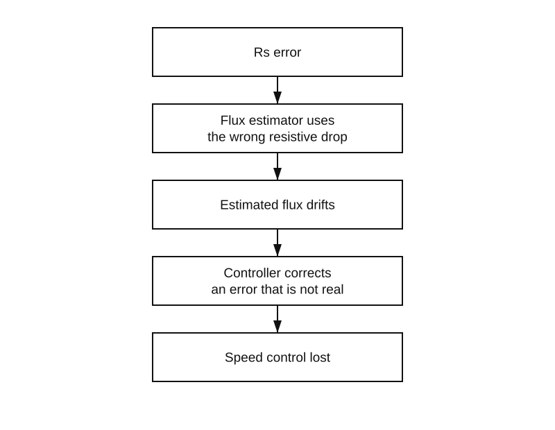
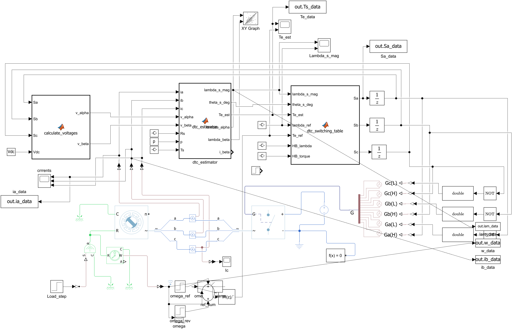
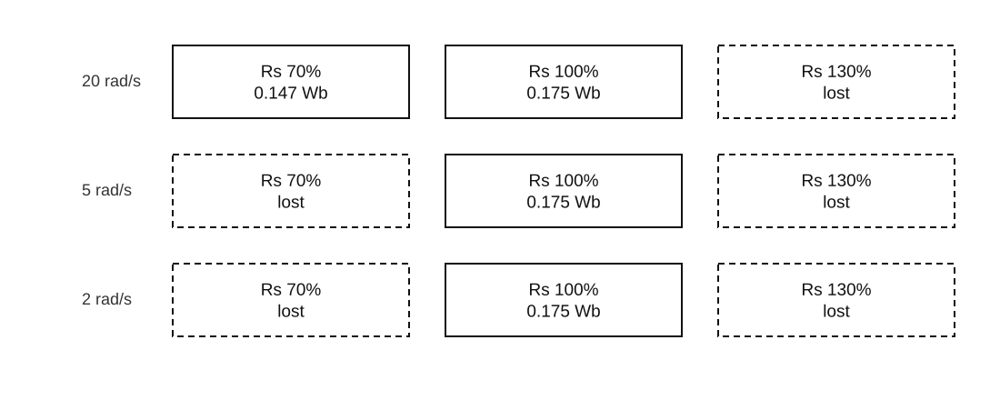
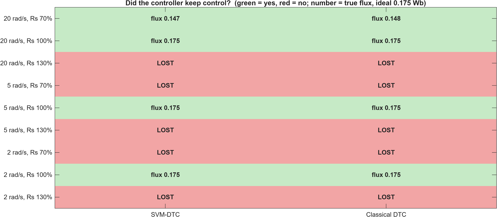
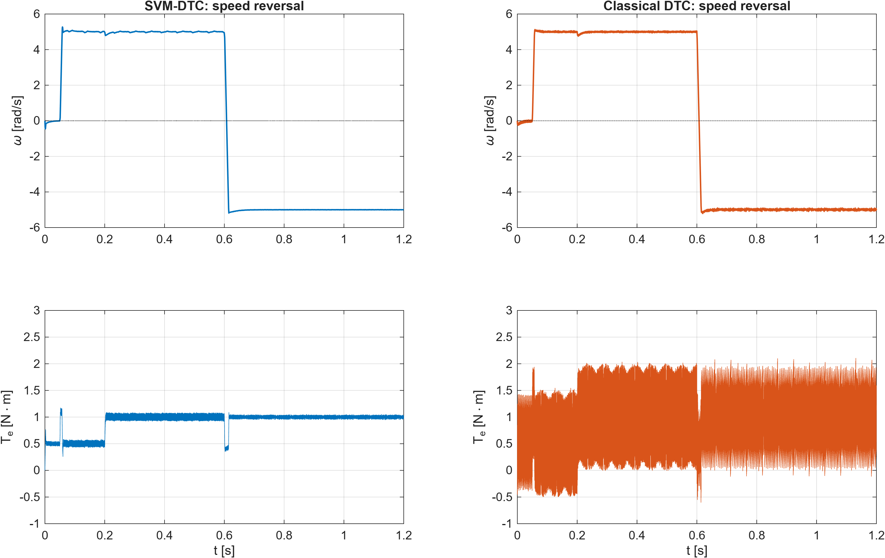

# Experiment 02 — Robustness to stator-resistance error

Sensitivity of the shared voltage-model flux estimator to stator-resistance error in SVM-DTC and classical DTC. The plant always uses the true Rs = 2.875 Ω; only the estimator resistance is changed.

## Summary

| Item | Detail |
|---|---|
| **Question** | Do the controllers survive when the flux estimator uses the wrong stator resistance, especially at low speed and through a reversal? |
| **What is varied** | Estimator Rs = 70%, 100%, 130% of the true 2.875 Ω; speeds 20, 5, 2 rad/s; one +5 → −5 rad/s reversal |
| **Controllers** | SVM-DTC and classical DTC, with two added hooks: estimator Rs multiplier and speed reversal |
| **Runs** | 20 simulations: 10 per controller |
| **Runtime** | ≈1 h per controller (machine-dependent); ≈2 h total |
| **Main result** | Both controllers fail in the same 5 of 9 Rs-mismatch cases; +30% fails at every speed, −30% only at low speed |
| **Software** | MATLAB R2026a (or compatible), Simulink, Simscape, Simscape Electrical |
| **Outputs** | 6 figures, `results/metrics_summary.csv`, 20 `.mat` files |

## Motivation

Stator resistance changes with winding temperature by tens of percent, so a practical drive must tolerate some Rs error. The relevant quantities are the error range that preserves control and the failure mode: a bounded flux bias or a divergent estimate. Both controllers use the same estimator, so a shared failure is attributable to the estimator rather than to the modulator.

## Nomenclature

| Symbol / term | Definition | Unit |
|---|---|---|
| **Rs** | Stator resistance, true value 2.875 Ω | Ω |
| **Rs_est** | Resistance used by the estimator, `Rs_est = Rs × Rs_factor` | Ω |
| **Rs_factor** | Estimator multiplier; 0.7 = Rs assumed 30% low, 1.3 = Rs assumed 30% high | — |
| **λs** | Stator flux linkage, nominal 0.175 Wb | Wb |
| **Flux estimator** | Voltage-model integrator producing λs from (v − Rs_est i); no flux sensor | — |
| **True flux** | Flux reconstructed from measured currents and rotor angle; used only for scoring | Wb |
| **ω** | Angular speed | rad/s |
| **Lost control** | Failure flag: instantaneous minimum true flux falls below 50% of 0.175 Wb (0.0875 Wb), or mean speed error exceeds 20% of the target | — |

## Flux estimator and Rs sensitivity

The estimator integrates the motor voltage minus the resistive drop:

```text
estimated flux = integral of (v - Rs_est * i)
```

An Rs error scales the subtracted term. A small mismatch leaves a bounded flux bias; a large positive mismatch can make the error grow. The estimator has no independent flux measurement with which to correct either condition.

## How Rs error enters the drive



*Figure 1. Rs error path: the estimator uses `Rs_est`, while the motor model retains the true Rs.*

Only the estimator changes. The motor model always uses the true Rs = 2.875 Ω. The estimator uses `Rs_est = Rs × Rs_factor`.

| Estimator Rs | What it subtracts | What happens at 20 rad/s |
|---|---|---|
| **70%** | Too little resistive drop | Kept control, but true flux settles at 0.147 Wb instead of 0.175 (−16%). The controller still believes 0.175. |
| **100%** | Correct drop | True flux 0.175 Wb. |
| **130%** | Too much resistive drop | The estimate runs away; true flux rises to 0.47–0.53 Wb and speed control is lost. |

## Whole-model screenshots



*Figure 2a. Classical DTC robustness model.*


*Figure 2b. SVM-DTC robustness model.*

Both models are the exp01 drives with two added hooks: an estimator Rs multiplier and a speed-reversal reference.

## Rs boundary



*Figure 3. Coarse Rs boundary from the 70/100/130% grid.*

At 20 rad/s the drive tolerates a 30% underestimate but not a 30% overestimate. At 5 and 2 rad/s it tolerates only the nominal value in this grid. The grid is coarse; exp03 resolves the boundary in 5–10% steps.

## Test matrix

| Set | Speed | Estimator Rs | Load | Analysis window | Cases per controller |
|---|---|---|---|---|---|
| 1. Medium | 20 rad/s | 70 / 100 / 130% | 0.5 → 2 N·m at 0.3 s | 0.5–0.8 s | 3 |
| 2. Low | 5 and 2 rad/s | 70 / 100 / 130% | 0.5 → 2 N·m at 0.3 s | 0.5–0.9 s | 6 |
| 3. Reversal | +5 → −5 rad/s at 0.6 s | 100% | 0.5 → 1 N·m at 0.2 s | 0.4–0.6 s and 0.9–1.2 s | 1 |

Total: 20 simulations (10 per controller). Controller sample time is 20 µs, same as exp01.

## How to run

From the repository root:

```matlab
cd('experiments/exp02_robustness')
setup_paths
sel = 1; run_all   % SVM-DTC, about 1 h
sel = 2; run_all   % classical DTC, about 1 h
make_results       % 6 figures + results/metrics_summary.csv
```

Run the two `sel` lines in separate MATLAB sessions if RAM allows; otherwise call `run_all` once and wait. Existing `results/result_*.mat` files are skipped, so interrupted runs resume.

`setup_paths` adds `models/`, `scripts/` and the shared `tools/` folder to the MATLAB path, and sends Simulink's generated cache to a temp folder.

## Files and outputs

```text
exp02_robustness/
├── models/    svm_dtc_rob.slx, classic_dtc_rob.slx
├── scripts/   pmsm_dtc_parameters.m, dtc_metrics.m, run_case.m,
│              run_all.m, make_results.m, build_robustness.m
├── results/   result_<tag>.mat (20), metrics_summary.csv
└── figures/   fig01 ... fig06  (PNG + PDF)
```

| Output | What it contains |
|---|---|
| `results/metrics_summary.csv` | 22 rows: 9 cases per controller plus the forward and reverse windows of the reversal. |
| `figures/fig01` | Estimated vs true flux at 20 rad/s for 70/100/130%. |
| `figures/fig02–fig04` | Speed responses at 20, 5 and 2 rad/s. |
| `figures/fig05` | Pass/fail map for all 9 Rs-mismatch cases. |
| `figures/fig06` | Speed and torque during the +5 → −5 rad/s reversal. |

`build_robustness.m` documents the two hooks added to the models; it is not needed for reproduction.

A fresh clone may not include the large `.mat` files; regenerate them with `run_all`.

## Key results

### Rs mismatch: true flux and outcome

Values are true flux mean (nominal 0.175 Wb). "kept control" means the failure criterion was not met; "lost control" means it was met.

| Case | SVM-DTC | Classical DTC |
|---|---|---|
| 20 rad/s, Rs 70% | kept control, 0.147 Wb | kept control, 0.148 Wb |
| 20 rad/s, Rs 100% | kept control, 0.175 Wb | kept control, 0.175 Wb |
| 20 rad/s, Rs 130% | lost control | lost control |
| 5 rad/s, Rs 70 / 100 / 130% | lost / kept / lost | lost / kept / lost |
| 2 rad/s, Rs 70 / 100 / 130% | lost / kept / lost | lost / kept / lost |
| Reversal, nominal Rs | kept control, ripple 0.031 / 0.020 N·m | kept control, ripple 0.445 / 0.434 N·m |

At 130% the estimated flux ran away to 16–24 Wb (nominal 0.175 Wb). The true flux rose to about 0.47–0.53 Wb, and the speed swung or stalled.

At nominal Rs, SVM-DTC keeps its advantage at low speed: true torque ripple is 0.033 vs 0.443 N·m at 2 rad/s, and 0.037 vs 0.445 N·m at 5 rad/s (≈12–14× lower). During the reversal, the forward/reverse ripple is 0.031/0.020 N·m for SVM-DTC vs 0.445/0.434 N·m for classical DTC.

### Figures



*Figure 4. Pass/fail map. Green: kept control; red: lost control. The number is true flux mean (nominal 0.175 Wb).*


*Figure 5. Estimated vs true flux at 20 rad/s. At Rs 70% the estimate (grey) looks healthy while the true flux (colored) is 16% low. At Rs 130% both run away.*



*Figure 6. +5 → −5 rad/s with the correct Rs. Both controllers pass through standstill; SVM-DTC torque is smoother.*

## Discussion

- **Shared estimator failure:** both controllers fail in the same cases. Changing the modulator does not change the outcome; the estimator is the common element.
- **Bounded bias at 70% and 20 rad/s:** the drive holds speed and appears healthy, but true flux is 16% low. The controller has no measurement that reveals this offset.
- **Divergent estimate at 130%:** the estimate runs away, true flux roughly triples, and speed control is lost at every speed tested.
- **Low-speed sensitivity:** at 5 and 2 rad/s, even a 30% underestimate fails. Mean flux can remain near 0.17 Wb while the speed error is large; back-EMF is small, so the resistive error is a larger fraction of the voltage.

## Limitations

- **Coarse Rs grid:** only 70/100/130% was tested, so the true boundary is unknown. exp03 fills the gap.
- **One load profile:** 0.5 → 2 N·m (1 N·m for reversal); no load sweep.
- **Threshold, not proof:** "lost control" is a flag based on flux and speed thresholds, not a formal stability proof.
- **Hypothesis:** the positive-feedback explanation for the 130% runaway is plausible but not verified by a separate test.
- **Simple estimator:** pure voltage-model integrator with no drift compensation; ideal inverter, no dead time; inverted current sensors with a −1 sign; SPMSM assumption.
- **Simulation only:** one motor, one DC bus, no hardware validation.
- **Not tested here:** current-sensor offset and inverter dead time.

## References

Reference list and BibTeX keys: [refs.bib](../../reports/final_2026-11/refs.bib).

- Hu, J., & Wu, B. (1998). New integration algorithms for estimating motor flux over a wide speed range. *IEEE Trans. Power Electron.* Key: `hu1998`.
- Haque, M. E., & Rahman, M. F. (2000). A PI stator resistance compensator for a direct torque controlled interior permanent magnet synchronous motor drive. *Proc. IEEE IPEMC.* Key: `haque2000`.
- Buja, G. S., & Kazmierkowski, M. P. (2004). Direct torque control of PWM inverter-fed AC motors — a survey. *IEEE Trans. Ind. Electron.* Key: `buja2004`.
- Kadjoudj, M., Golea, N., & Benbouzid, M. E. H. (2007). Problems of stator flux estimation in DTC of PMSM drives. *J. Elect. Eng. Technol.* Key: `kadjoudj2007`.

Next: [Experiment 03 — finer Rs boundary](../exp03_rs_boundary/README.md)
