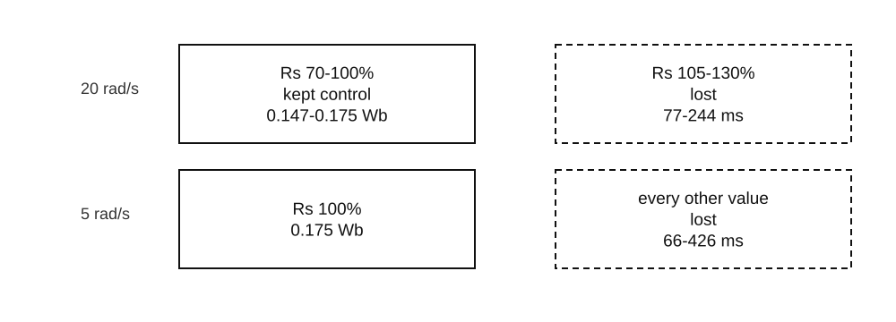
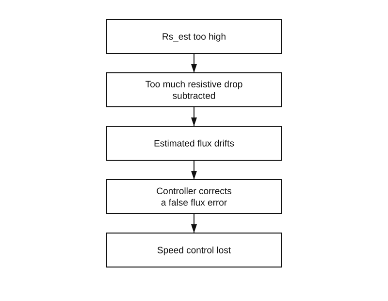
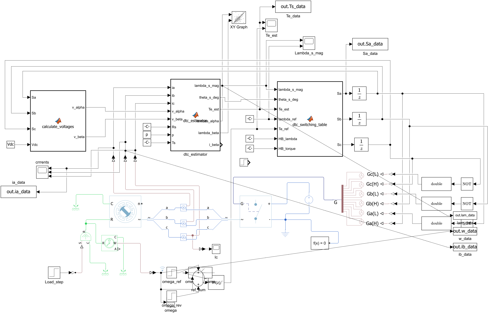
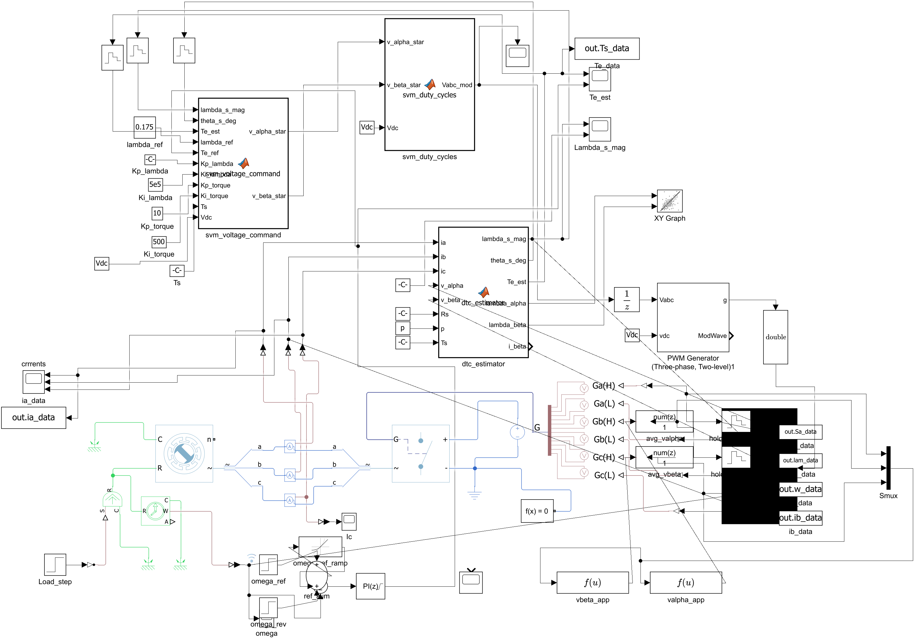
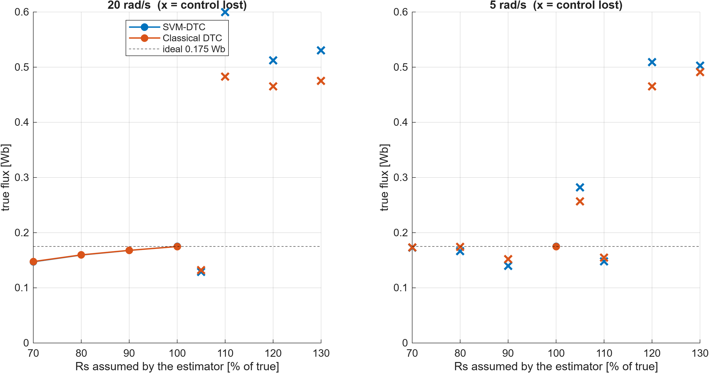
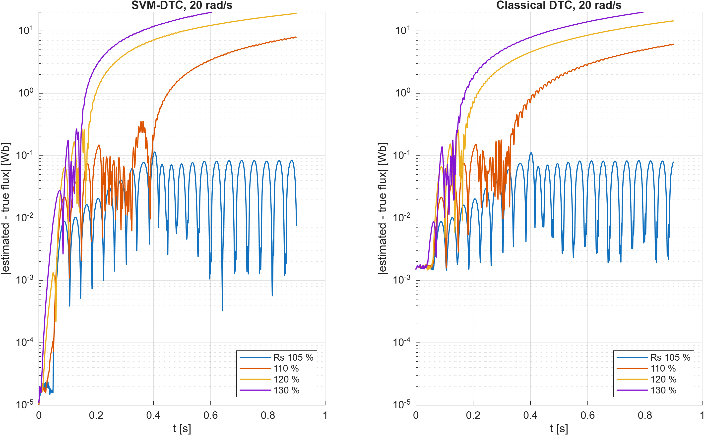

# Experiment 03 — Fine-grained Rs boundary

Fine Rs sweep at 20 and 5 rad/s, extending the 70/100/130% grid of exp02. Eight estimator-resistance values are evaluated for both controllers.

## Summary

| Item | Detail |
|---|---|
| **Question** | How small must the estimator's Rs error be for the drive to keep control? |
| **What is varied** | Estimator Rs = 70, 80, 90, 100, 105, 110, 120, 130% of true 2.875 Ω |
| **Speeds** | 20 rad/s and 5 rad/s |
| **Controllers** | SVM-DTC and classical DTC |
| **Runs** | 20 new simulations + 12 matching cases reused from exp02 = 32 result rows |
| **Runtime** | ≈2 h total (machine-dependent); split with `sel = 1` / `sel = 2` |
| **Main result** | At 20 rad/s: control kept up to 100% (with a bias below 100%), lost at +5%. At 5 rad/s: only 100% survives. |
| **Software** | MATLAB R2026a (or compatible), Simulink, Simscape, Simscape Electrical |
| **Outputs** | 3 figures, `results/metrics_summary.csv`, 20 new `.mat` files |

## Motivation

- Copper resistance changes by tens of percent between cold and hot, so a 5% estimator error is realistic.
- In the tested grid, +5% is sufficient for loss of control at 20 rad/s; at 5 rad/s only the exact value survives.
- Both controllers share the failure, so the corrective mechanism must be in the flux estimator. This map is the benchmark for an improved estimator.

## Rs boundary



*Figure 1. Fine Rs boundary at 20 and 5 rad/s. Filled markers are kept-control cases; crosses are lost-control cases.*

> **Boundary:** at 20 rad/s, +5% causes loss of control; at 5 rad/s, −10% is sufficient.

## Nomenclature

| Symbol / term | Definition | Unit |
|---|---|---|
| **Rs** | Stator resistance, true value 2.875 Ω | Ω |
| **λs** | Stator flux linkage, nominal 0.175 Wb | Wb |
| **Flux estimator** | Voltage-model integrator using Rs assumed; no flux sensor | — |
| **Rs assumed** | Estimator resistance as a percentage of true Rs; 105% = 5% high | % |
| **ω** | Angular speed | rad/s |
| **Boundary** | Smallest Rs error that causes loss of control | % |
| **Failure time** | First time the smoothed flux error exceeds 0.03 Wb; an indicator, not the exact instability onset | ms |
| **Growth rate** | Exponential rate of flux-error growth, in 1/s, fitted from the simulated waveform | 1/s |

## How Rs error becomes instability



*Figure 2. Rs error enters through the flux estimator; the plant retains the true resistance.*

The hypothesis from exp02 is that the flux-error dynamics are approximately

```text
d(err)/dt = ((Rs_est - Rs) / L) * err + forcing
```

Here `L` is the stator inductance (8.5 mH). A positive mismatch (`Rs_est > Rs`) should grow, while a negative mismatch should decay. This experiment tests that relation.

The sign asymmetry is confirmed, but the simple formula is not quantitatively accurate; see [Growth-rate model](#growth-rate-model).

| Direction | 20 rad/s | 5 rad/s | Observed behavior |
|---|---|---|---|
| **Rs too low (70–90%)** | kept control, flux 4–16% low | lost control | bias, then low-speed failure |
| **Rs correct (100%)** | 0.175 Wb | 0.175 Wb | nominal |
| **Rs too high (105–130%)** | lost control | lost control | runaway |

## Whole-model screenshots



*Figure 3a. Classical DTC Rs boundary model.*



*Figure 3b. SVM-DTC Rs boundary model.*

These are the complete top-level models used for the fine Rs sweep.

## Test matrix

| Group | Rs values | Speeds | Controllers | Result rows |
|---|---|---|---|---|
| Reused from exp02 | 70, 100, 130% | 20, 5 rad/s | both | 12 |
| New in exp03 | 80, 90, 105, 110, 120% | 20, 5 rad/s | both | 20 |
| **Total** | 8 values | 2 speeds | 2 | **32** |

Load: 0.5 → 2 N·m at 0.3 s; analysis window 0.5–0.9 s. Controller sample time 20 µs, same as exp01 and exp02.

## How to run

From the repository root:

```matlab
cd('experiments/exp03_rs_boundary')
setup_paths
run_all        % 20 new simulations, about 2 h
make_results   % 3 figures + results/metrics_summary.csv
```

`make_results` also reads the 70/100/130% cases from `../exp02_robustness/results`. Keep those result files (or run exp02 first) to get the full 8-point map.

To split the work:

```matlab
sel = 1; run_all   % SVM-DTC
sel = 2; run_all   % classical DTC
```

Existing `results/result_*.mat` files are skipped, so the run resumes.

## Files and outputs

```text
exp03_rs_boundary/
├── models/    svm_dtc_rs.slx, classic_dtc_rs.slx
├── scripts/   pmsm_dtc_parameters.m, dtc_metrics.m, run_case.m,
│              run_all.m, make_results.m
├── results/   result_<tag>.mat (20 new), metrics_summary.csv
└── figures/   fig01 ... fig03  (PNG + PDF)
```

| Output | What it contains |
|---|---|
| `results/metrics_summary.csv` | 32 rows: true flux, flux error, speed error, lost flag, failure time, measured vs predicted growth rate. |
| `figures/fig01_true_flux_vs_assumed_Rs.png` | True flux vs assumed Rs; filled dots = kept control, crosses = lost. |
| `figures/fig02_growth_rate_measured_vs_predicted.png` | Measured vs predicted growth rate. |
| `figures/fig03_flux_error_growth_log.png` | Flux-error magnitude on a log scale at 20 rad/s. |

A fresh clone may not include the large `.mat` files; regenerate them with `run_all`.

## Key results

### Outcome map

For kept-control rows the number is true flux mean. For lost-control rows the number is failure time, SVM-DTC / classical DTC. Flux values are from SVM-DTC; for kept-control rows classical DTC is within 0.001 Wb.

| Rs assumed | 20 rad/s | 5 rad/s |
|:--:|---|---|
| **70%** | kept control, 0.147 Wb | lost control, 258 / 257 ms |
| **80%** | kept control, 0.160 Wb | lost control, 330 / 330 ms |
| **90%** | kept control, 0.168 Wb | lost control, 425 / 426 ms |
| **100%** | kept control, 0.175 Wb | kept control, 0.175 Wb |
| **105%** | lost control, 244 / 245 ms | lost control, 285 / 286 ms |
| **110%** | lost control, 121 / 121 ms | lost control, 111 / 110 ms |
| **120%** | lost control, 77 / 75 ms | lost control, 89 / 84 ms |
| **130%** | lost control, 89 / 78 ms | lost control, 66 / 78 ms |

Failure time = first time the 2 ms-smoothed `|estimated − true flux|` exceeds 0.03 Wb. It marks when the estimate has clearly gone wrong, not the exact onset of instability.

### Growth-rate model

| Rs assumed | Predicted growth k (1/s) | Measured k, SVM / classical (1/s) |
|---|---:|---:|
| 105% | 16.9 | 6.9 / 7.2 |
| 110% | 33.8 | 12.7 / 14.6 |
| 120% | 67.6 | 183.7 / 170.6 |
| 130% | 101.5 | 31.0 / 37.1 |

The measured rates are about 0.3–2.7× the prediction and are not monotonic. At +5% the flux error stays bounded around 0.08 Wb peak, yet speed regulation is still lost. The qualitative sign asymmetry holds, but the simple formula ignores the speed ramp and load step.

### Figures



*Figure 4. True flux vs assumed Rs. At 20 rad/s the kept-control range ends at 100%; at 5 rad/s only 100% keeps control. The 70–90% points keep control but sit below the 0.175 Wb line.*



*Figure 5. Flux-error magnitude at 20 rad/s on a log scale. Exponential growth would be a straight rising line; the measured curves bend and saturate.*


*Figure 6. Measured vs predicted growth rate. Points would lie on the dashed line if the simple formula were exact; they do not.*

## Discussion

- **Controller-independent:** SVM-DTC and classical DTC have the same pass/fail pattern. Failure times usually agree within 1–2 ms and at worst about 12 ms (20 rad/s/130%: 89 vs 78 ms; 5 rad/s/130%: 66 vs 78 ms). The shared estimator, not the modulator, determines the outcome.
- **Sign asymmetry at 20 rad/s:** underestimates of 10–30% keep control but leave a bias. True flux is 0.168, 0.160 and 0.147 Wb at 90, 80 and 70% (4%, 9% and 16% low). Any overestimate of 5% or more loses control.
- **No tolerance at 5 rad/s:** every mismatch fails: −30% to −10% and +5% to +30%. Some cases still have a near-nominal mean flux (about 0.17 Wb), but the speed criterion is violated. At this speed the larger mismatch usually fails sooner (130% at 66 ms vs 105% at 285 ms).
- **Model accuracy:** growth rates differ from the prediction by factors of about 0.3–2.7, and the +5% case stays bounded yet still loses speed. The failures cluster around the speed ramp (0.05 s) and the load step (0.3 s), which the formula does not model.

## Limitations

- **Two speeds only:** 20 and 5 rad/s; one load profile (0.5 → 2 N·m).
- **Coarse near the boundary:** 5% steps. At 20 rad/s the boundary lies between 100 and 105%; at 5 rad/s the safe interval around 100% is unresolved and could be only a few percent.
- **Threshold, not proof:** "lost control" is a flag (true flux < 50% of 0.175 Wb, or mean speed error > 20% of target); failure time is a 0.03 Wb crossing, not the exact onset of instability.
- **Crude growth fits:** the fit window includes the speed ramp and load step, so the measured growth rates are indicative.
- **Mixed sources:** the 70/100/130% rows are reused from exp02, not rerun here (same models and conditions).
- **Model limitations:** pure voltage-model integrator, ideal inverter with no dead time, inverted current sensors, SPMSM assumption, simulation only.

## References

Reference list and BibTeX keys: [refs.bib](../../reports/final_2026-11/refs.bib).

- Zhong, L., Rahman, M. F., Hu, W. Y., & Lim, K. W. (1997). Analysis of direct torque control in permanent magnet synchronous motor drives. *IEEE Trans. Power Electron.* Key: `zhong1997`.
- Hu, J., & Wu, B. (1998). New integration algorithms for estimating motor flux over a wide speed range. *IEEE Trans. Power Electron.* Key: `hu1998`.
- Haque, M. E., & Rahman, M. F. (2000). A PI stator resistance compensator for a direct torque controlled interior permanent magnet synchronous motor drive. *Proc. IEEE IPEMC.* Key: `haque2000`.
- Kadjoudj, M., Golea, N., & Benbouzid, M. E. H. (2007). Problems of stator flux estimation in DTC of PMSM drives. *J. Elect. Eng. Technol.* Key: `kadjoudj2007`.

## Further work

- Resolve the low-speed boundary with ±1–3% steps.
- Test an Rs-adaptive flux estimator against this map.
