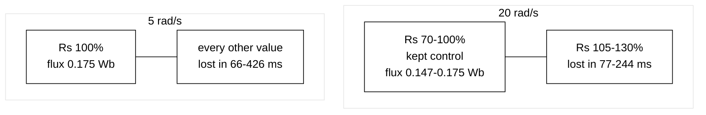
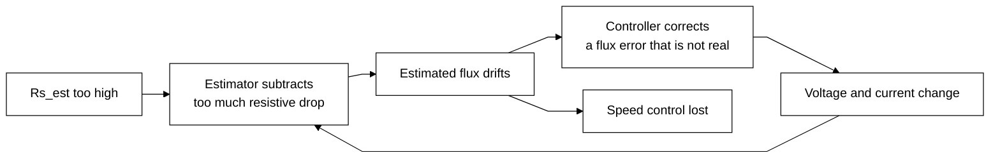
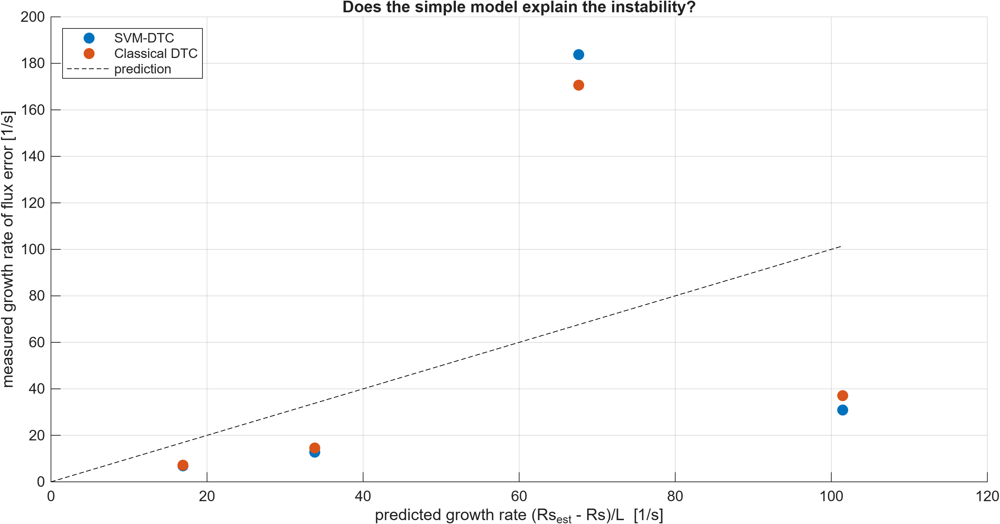

# Experiment 03 — Where exactly does Rs error break the drive?

**exp02 showed ±30% is bad. This one walks the boundary in 5–10% steps.**

## At a glance

| | |
|---|---|
| **Question** | How small must the estimator's Rs error be for the drive to keep control? |
| **What is varied** | Estimator Rs = 70, 80, 90, 100, 105, 110, 120, 130% of true 2.875 Ω |
| **Speeds** | 20 rad/s and 5 rad/s |
| **Controllers** | SVM-DTC and classical DTC |
| **Runs** | 20 new simulations + 12 matching cases reused from exp02 = 32 result rows |
| **Runtime** | ≈2 h total (machine-dependent); split with `sel = 1` / `sel = 2` |
| **Main result** | At 20 rad/s: control kept up to 100% (with a bias below 100%), lost at +5%. At 5 rad/s: only 100% survives. |
| **Software** | MATLAB R2026a (or compatible), Simulink, Simscape, Simscape Electrical |
| **Outputs** | 3 figures, `results/metrics_summary.csv`, 20 new `.mat` files |

## The answer in one picture



> **Boundary:** at 20 rad/s, +5% is already fatal. At 5 rad/s, even −10% is fatal.

## Words you need

| Term | Plain meaning |
|---|---|
| **Rs** | Stator resistance — the copper resistance of the motor windings. True value 2.875 Ω. |
| **Flux** | Magnetic strength in the stator. The controller estimates it because there is no flux sensor. |
| **Wb** | Weber — the unit of magnetic flux. Nominal value here: 0.175 Wb. |
| **Rs assumed** | The value the estimator uses, shown as % of the true Rs. 105% = 5% too high. |
| **rad/s** | Angular speed. 2π rad/s ≈ one revolution per second. |
| **Boundary** | The smallest Rs error that makes the drive lose control. |
| **Failure time** | First time the smoothed flux error exceeds 0.03 Wb; an indicator, not the exact instability onset. |
| **Growth rate** | How fast the flux error grows, in 1/s, fitted from the simulated waveform. |

## How Rs error becomes instability



**The hypothesis from exp02:** the flux-error dynamics are approximately

```text
d(err)/dt = ((Rs_est - Rs) / L) * err + forcing
```

Here `L` is the stator inductance (8.5 mH). A positive mismatch (`Rs_est > Rs`) should grow, while a negative mismatch should decay. This experiment tests that idea.

**What actually happens:** the sign asymmetry is confirmed, but the simple formula is not quantitatively accurate. See [Was the simple model right?](#was-the-simple-model-right).

| Direction | 20 rad/s | 5 rad/s | What you see |
|---|---|---|---|
| **Rs too low (70–90%)** | ✅ kept control, flux 4–16% low | ❌ lost | bias, then low-speed failure |
| **Rs correct (100%)** | ✅ 0.175 Wb | ✅ 0.175 Wb | nominal |
| **Rs too high (105–130%)** | ❌ lost | ❌ lost | runaway |

## Whole-model screenshots

<p align="center">
  
  
</p>

These are the complete top-level models used for the fine Rs sweep.

## Test matrix

| Group | Rs values | Speeds | Controllers | Result rows |
|---|---|---|---|---|
| Reused from exp02 | 70, 100, 130% | 20, 5 rad/s | both | 12 |
| New in exp03 | 80, 90, 105, 110, 120% | 20, 5 rad/s | both | 20 |
| **Total** | 8 values | 2 speeds | 2 | **32** |

Load: 0.5 → 2 N·m at 0.3 s; analysis window 0.5–0.9 s. Controller sample time 20 µs, same as exp01 and exp02.

## How to run

From the repository root:

```matlab
cd('experiments/exp03_rs_boundary')
setup_paths
run_all        % 20 new simulations, about 2 h
make_results   % 3 figures + results/metrics_summary.csv
```

`make_results` also reads the 70/100/130% cases from `../exp02_robustness/results`. Keep those result files (or run exp02 first) to get the full 8-point map.

To split the work:

```matlab
sel = 1; run_all   % SVM-DTC
sel = 2; run_all   % classical DTC
```

Existing `results/result_*.mat` files are skipped, so the run resumes.

## Files and outputs

```text
exp03_rs_boundary/
├── models/    svm_dtc_rs.slx, classic_dtc_rs.slx
├── scripts/   pmsm_dtc_parameters.m, dtc_metrics.m, run_case.m,
│              run_all.m, make_results.m
├── results/   result_<tag>.mat (20 new), metrics_summary.csv
└── figures/   fig01 ... fig03  (PNG + PDF)
```

| Output | What it contains |
|---|---|
| `results/metrics_summary.csv` | 32 rows: true flux, flux error, speed error, lost flag, failure time, measured vs predicted growth rate. |
| `figures/fig01_true_flux_vs_assumed_Rs.png` | True flux vs assumed Rs; filled dots = kept control, crosses = lost. |
| `figures/fig02_growth_rate_measured_vs_predicted.png` | Measured vs predicted growth rate. |
| `figures/fig03_flux_error_growth_log.png` | Flux-error magnitude on a log scale at 20 rad/s. |

A fresh clone may not include the large `.mat` files; regenerate them with `run_all`.

## Key results

### Outcome map

`✅` = kept control; the number is true flux mean. `❌` = lost control; the number is the failure time, SVM-DTC / classical DTC. Flux values are from SVM-DTC; classical DTC is within 0.001 Wb.

| Rs assumed | 20 rad/s | 5 rad/s |
|:--:|---|---|
| **70%** | ✅ 0.147 Wb | ❌ 258 / 257 ms |
| **80%** | ✅ 0.160 Wb | ❌ 330 / 330 ms |
| **90%** | ✅ 0.168 Wb | ❌ 425 / 426 ms |
| **100%** | ✅ 0.175 Wb | ✅ 0.175 Wb |
| **105%** | ❌ 244 / 245 ms | ❌ 285 / 286 ms |
| **110%** | ❌ 121 / 121 ms | ❌ 111 / 110 ms |
| **120%** | ❌ 77 / 75 ms | ❌ 89 / 84 ms |
| **130%** | ❌ 89 / 78 ms | ❌ 66 / 78 ms |

Failure time = first time the 2 ms-smoothed `|estimated − true flux|` exceeds 0.03 Wb. It marks when the estimate has clearly gone wrong, not the exact onset of instability.

### Was the simple model right?

| Rs assumed | Predicted growth k (1/s) | Measured k, SVM / classical (1/s) |
|---|---:|---:|
| 105% | 16.9 | 6.9 / 7.2 |
| 110% | 33.8 | 12.7 / 14.6 |
| 120% | 67.6 | 183.7 / 170.6 |
| 130% | 101.5 | 31.0 / 37.1 |

The measured rates are about 0.3–2.7× the prediction and are not monotonic. At +5% the flux error stays bounded around 0.08 Wb peak, yet speed regulation is still lost. So the qualitative story (positive mismatch is dangerous) holds, but the simple formula ignores the speed ramp and load step.

### Figures


*True flux vs assumed Rs. At 20 rad/s the kept-control range ends at 100%; at 5 rad/s only 100% is green. The 70–90% points keep control but sit below the 0.175 Wb line.*


*Flux-error magnitude at 20 rad/s on a log scale. Exponential growth would be a straight rising line; the real curves bend and saturate.*



*Measured vs predicted growth rate. Points would lie on the dashed line if the simple formula were exact; they do not.*

## What the data say

- **Controller-independent.** SVM-DTC and classical DTC have the same pass/fail pattern. Failure times usually agree within 1–2 ms and at worst about 12 ms (20 rad/s/130%: 89 vs 78 ms; 5 rad/s/130%: 66 vs 78 ms). The shared estimator is the weak point, not the modulator.
- **Sign asymmetry at 20 rad/s.** Underestimates of 10–30% keep control but leave a bias: true flux 0.168, 0.160 and 0.147 Wb at 90, 80 and 70% (4%, 9% and 16% low). Any overestimate of 5% or more loses control.
- **No tolerance at 5 rad/s.** Every mismatch fails: −30% to −10% and +5% to +30%. Some of these cases still have a near-nominal mean flux (about 0.17 Wb), but the speed criterion is violated. At this speed the larger mismatch usually fails sooner (130% at 66 ms vs 105% at 285 ms).
- **The formula is only qualitative.** Growth rates differ by factors of about 0.3–2.7, and the +5% case stays bounded yet still loses speed. The failures cluster around the speed ramp (0.05 s) and the load step (0.3 s), which the formula does not model.

## Why it matters

- A 5% resistance error is realistic: copper resistance changes by tens of percent between cold and hot.
- The drive has almost no margin in the dangerous direction: +5% is enough at 20 rad/s, and at 5 rad/s nothing except the exact value survives.
- The failure is shared by both controllers, so the fix must be an Rs-robust flux estimator. This map is the benchmark that an improved estimator must beat.

## Limitations

- **Two speeds only:** 20 and 5 rad/s; one load profile (0.5 → 2 N·m).
- **Coarse near the boundary:** 5% steps. At 20 rad/s the boundary lies between 100 and 105%; at 5 rad/s the safe interval around 100% is unresolved and could be only a few percent.
- **Threshold, not proof:** "lost control" is a flag (true flux < 50% of 0.175 Wb, or mean speed error > 20% of target); failure time is a 0.03 Wb crossing, not the exact onset of instability.
- **Crude growth fits:** the fit window includes the speed ramp and load step, so the measured growth rates are indicative.
- **Mixed sources:** the 70/100/130% rows are reused from exp02, not rerun here (same models and conditions).
- **Model limitations:** pure voltage-model integrator, ideal inverter with no dead time, inverted current sensors, SPMSM assumption, simulation only.

Next questions: resolve the low-speed boundary with ±1–3% steps, then test an Rs-adaptive flux estimator against this map.
