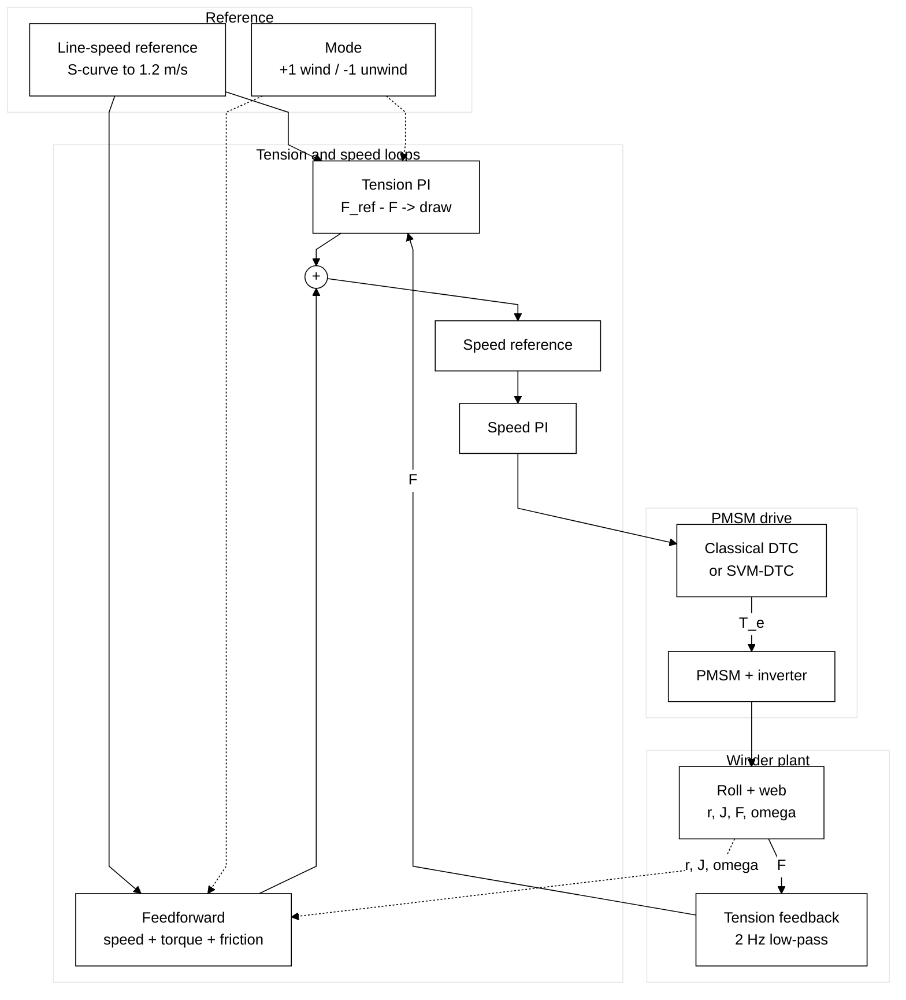
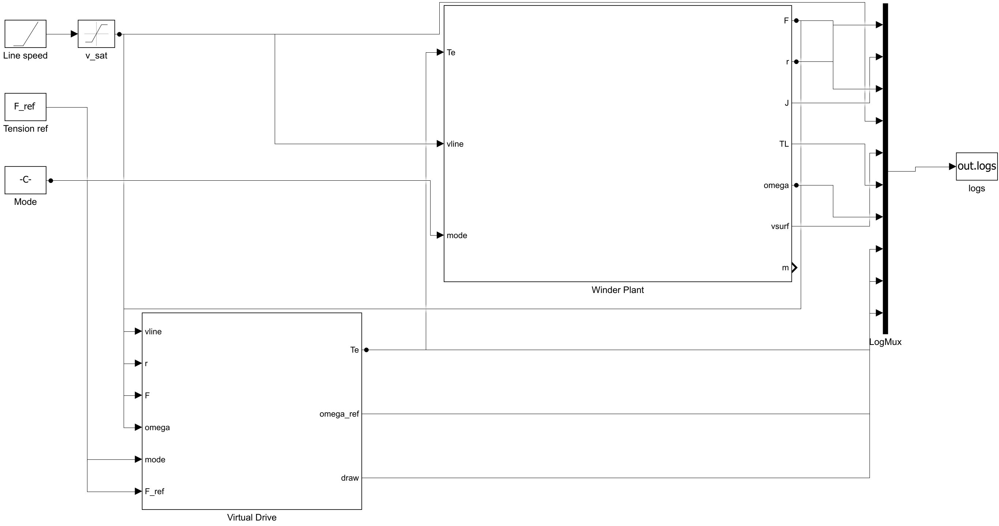
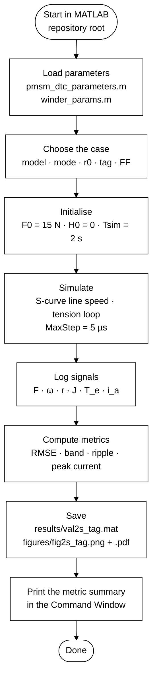
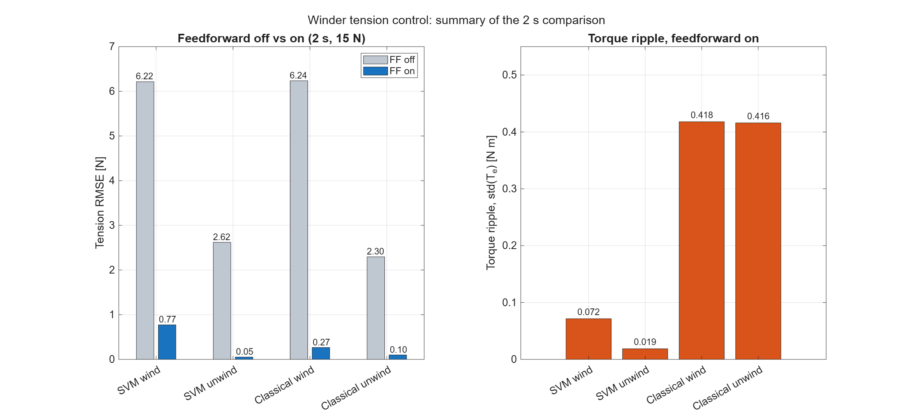
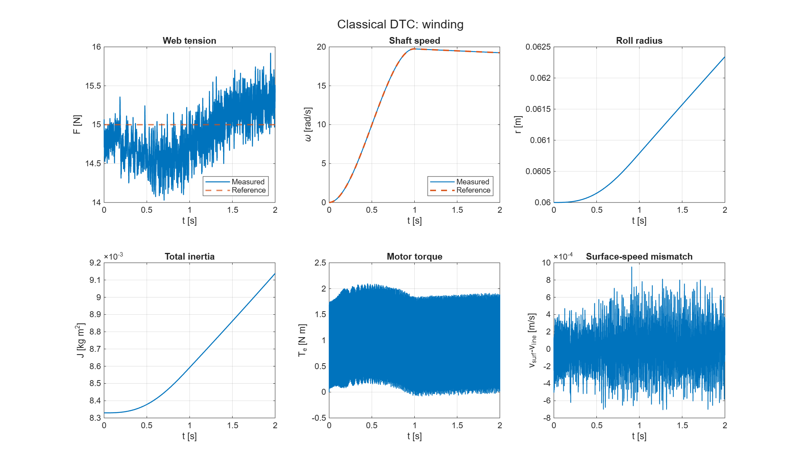

# Winder Tension Control with a PMSM Drive

**Experiment 05** · classical DTC vs SVM-DTC on the same variable-radius winder.

A winder pulls a paper-like web onto a roll. As the roll fills, its radius and inertia keep changing, yet the web must stay at **15 N**. This folder contains the mechanical plant, the tension loop, the feedforward, and a like-for-like comparison of two PMSM torque-control methods.

> **The one-line result:** feedforward cuts tension error by **88–98 %**. Classical DTC + FF gives the tightest tension band; SVM-DTC gives much lower torque ripple and draws less current.

## 60-second tour

| Question | Short answer |
|---|---|
| What is controlled? | Web tension at a 15 N setpoint |
| What is the actuator? | A permanent-magnet synchronous motor (PMSM) |
| What changes during a run? | Roll radius and inertia — growing when winding, shrinking when unwinding |
| What is compared? | Classical DTC vs SVM-DTC, each with feedforward off/on |
| What matters most? | Speed + torque feedforward |
| How long is one case? | 2 s of simulated time, 1 s speed ramp |

## 1. What is a winder?

A winder has three parts:

- a **roll** (core plus wound material) that turns,
- a **web** (paper, film, foil) pulled onto or off the roll,
- a **line** that supplies or takes away the web at a set speed.

**Winding** means the roll grows; **unwinding** means it shrinks. In both directions the roll surface speed and the line speed must match within a tiny margin, because tension — the force carried by the web, in newtons — is created by their difference:

```text
dF/dt = mode · K · (v_surf − v_line)      K = E·A/L ≈ 3.0e5 N/m
```

A fraction of a millimetre per second is enough to change tension quickly. That is why tension control is really a **speed-control problem in disguise**.

| Tension | What happens |
|---|---|
| Too low | Web goes slack, wrinkles, mistracks, and the roll winds loosely |
| Correct | Firm roll, no slip, consistent product |
| Too high | Web stretches or breaks; the motor and bearings work harder |

## 2. What the PMSM drive does

The PMSM is the **torque actuator**. It does not decide tension directly: the speed loop asks for torque, and the inner DTC controller produces it by switching the inverter.

**DTC (direct torque control)** chooses an inverter state directly from the flux and torque errors. **SVM-DTC** keeps the same flux/torque control idea but adds a space-vector modulator and PI regulators, so the inverter switches at a fixed frequency.

Two inner controllers are compared under identical mechanics:

| | Classical DTC | SVM-DTC |
|---|---|---|
| Switching | Hysteresis bands + switching table | Space-vector modulation at fixed frequency |
| Strong point | Simple, fast torque response | Smooth torque and current |
| Weak point | Higher ripple, variable switching | More tuning blocks (flux/torque PI) |
| Torque ripple here | ≈ 0.42 N·m | ≈ 0.02–0.08 N·m |
| Peak current here | ≈ 2.0–2.6 A | ≈ 1.2–1.9 A |

Both use the same voltage-model stator-flux estimator (λ ≈ 0.175 Wb), the same 20 µs controller step, and the same 5 N·m torque limit. The core controller, estimator, and modulation blocks were carried over from `exp03` unchanged.

## 3. How the pieces fit



Read it as three layers:

- **Tension loop (outer):** compares measured `F` with the 15 N reference. Its PI output is a small **draw** correction added to the roll speed. The sign flips with the mode: winding raises tension by speeding the roll up, unwinding by slowing it down.
- **Feedforward (parallel):** predicts the speed `v_line/r` and the torque needed for inertia, the changing inertia `(dJ/dt)`, web tension, and friction. The PI then only corrects the residual.
- **Drive (inner):** the speed PI turns speed error into a torque command; classical DTC or SVM-DTC turns that into inverter switching.

The line reference feeds both paths: it sets the baseline speed, while the tension PI trims it. In one sentence: **feedforward does the predictable work, feedback fixes what is left**.

The torque feedforward is:

```text
T_ff = J·dω_ref/dt + (dJ/dt)·ω_ref + mode·F_ref·r + B·ω_ref
       └── inertia ──┘ └ changing inertia ┘ └─ web ─┘ └ friction ┘
```

## 4. Model at a glance

| Layer | What is inside | Where |
|---|---|---|
| Winder plant | Variable-radius roll + Kelvin–Voigt (spring + dashpot) web; states `r`, `H = Jω`, `F` | `scripts/winder_plant_sfun.m` |
| Drive | PMSM + 2-level inverter, 20 µs controller step, 5 N·m limit | `models/` (from `exp03`) |
| Estimator | Voltage-model stator flux from inverter voltage and current; λ ≈ 0.175 Wb, shared by both drives | `models/` (from `exp03`) |
| Controllers | Classical DTC or SVM-DTC, plus the speed PI | `models/*.slx` |
| Tension loop | PI + slack take-up + 2 Hz feedback filter, 15 N setpoint | `scripts/add_tension_control.m` |
| Feedforward | Speed `v_line/r` + torque (inertia, `dJ/dt`, web, friction) | `scripts/add_feedforward.m` |


*The plant block: inputs `Te`, `v_line`, `mode`; outputs `F`, `r`, `J`, `TL`, `omega`, `v_surf`, `m`.*

### Whole-model screenshots

<p align="center">
  
  
</p>

<p align="center">
  
</p>

These are the complete top-level models: drive, estimator, controller, winder plant, tension loop, feedforward, and logging.

## 5. What happens in one simulation run



A single 2 s case takes a few minutes, because the solver is limited to 5 µs steps.

## 6. Key results



*Left: tension RMSE collapses when feedforward is enabled. Right: classical DTC has roughly 5–20× the torque ripple of SVM-DTC.*

| Configuration | F RMSE | F range | Torque ripple | Current peak |
|---|---:|---:|---:|---:|
| SVM wind, FF off | 6.215 N | 0.00–22.72 N | 0.075 N·m | 1.40 A |
| SVM wind, FF on | 0.772 N | 10.01–17.29 N | 0.075 N·m | 1.22 A |
| Classical wind, FF off | 6.236 N | 0.00–22.06 N | 0.420 N·m | 2.16 A |
| Classical wind, FF on | **0.267 N** | 14.03–15.92 N | 0.420 N·m | 1.98 A |
| SVM unwind, FF on | **0.052 N** | 8.84–17.38 N | **0.019 N·m** | 1.72 A |
| Classical unwind, FF on | 0.100 N | 13.43–16.75 N | 0.414 N·m | 2.55 A |

*F RMSE and ripple use 1.3–2.0 s; range and peak current use the full run. All cases: 15 N setpoint, 2 s, no torque saturation.*

**What the table says**

- Feedforward is the dominant improvement: **88–98 % lower tension RMSE** and no startup slack.
- Classical DTC + FF gives the tightest tension band, but with 5–20× more torque ripple and higher peak current.
- SVM-DTC + FF is the smoothest option and draws the least current. Its winding case still has brief dips to ~10 N; they are bounded, not eliminated.
- Unwinding benefits most: SVM reaches **0.052 N** RMSE with only 0.019 N·m ripple.

The full 18-case matrix, including speed/radius robustness and a tension step, is in `results/final_matrix.csv`.

## 7. What the curves look like

| SVM-DTC, winding, FF on | Classical DTC, winding, FF on |
|---|---|
|  |  |

Both panels show tension, shaft speed, roll radius, inertia, motor torque, and surface-speed mismatch. The classical drive holds a tighter tension band but shows visibly larger torque ripple; the SVM drive is calmer electrically, with short tension dips during the ramp.

## 8. How to run one case

From the repository root, in MATLAB with Simulink and Simscape:

```matlab
cd('experiments/exp05_winder_mechanics')
addpath(fullfile(pwd,'models'), fullfile(pwd,'scripts'), fullfile(pwd,'..','..','tools'))
run('..\exp03_rs_boundary\scripts\pmsm_dtc_parameters.m')
run('scripts\winder_params.m')
met = run_case_2s('classic_dtc_winder', +1, 0.06, 'my_test', 1, 1);
```

| Argument | Example | Meaning |
|---|---|---|
| `model` | `'classic_dtc_winder'` | or `'svm_dtc_winder'` |
| `mode` | `+1` | `+1` winding, `−1` unwinding |
| `r0` | `0.06` | initial radius, m (`0.06` wind / `0.115` unwind) |
| `tag` | `'my_test'` | suffix for the output files |
| `ffon` | `1` | `0` feedforward off, `1` on |
| `fffull` | `1` | `1` full feedforward, `0` inertia-only |

The function sets `Tsim = 2 s`, `T_ramp = 1 s`, enables the 2 Hz tension filter, and uses `MaxStep = 5e-6`. To reproduce all 18 cases in the study, run `scripts/run_final_matrix.m`.

## 9. What you get

| Output | Path | Contents |
|---|---|---|
| Data | `results/val2s_<tag>.mat` | `t`, `F`, `omg`, `wr`, `vl`, `r`, `J`, `TL`, `Te`, `ia`, `met` |
| Figure | `figures/fig2s_<tag>.png` | Six-panel summary at 300 dpi |
| Vector figure | `figures/fig2s_<tag>.pdf` | Same figure for reports |
| Editable figure | `figures/fig2s_<tag>.fig` | MATLAB figure file |
| Console | Command Window | Printed metric summary |

The printed summary contains tension RMSE, min/max/mean tension, speed RMSE, torque ripple, peak and RMS current, saturation time, torque-balance residual, and wall-clock time.

## Good to know

- The mechanical parameters are **illustrative**, not measured material data.
- This is a simulation study: one web material, a taut-web model, and no experimental validation.
- The SVM winding dips near 0.1/0.2/0.58 s are a known limitation of this plant/controller pairing.
- Classical DTC's higher ripple is inherent to its hysteresis switching, not a tuning mistake.

## Read next

- **[TECHNICAL_NOTES.md](TECHNICAL_NOTES.md)** — the complete experiment log: derivations, dead ends, acceptance checks, and every intermediate result.
- **[Final report (PDF)](../../reports/final_2026-11/main.pdf)** — the consolidated write-up with figures and conclusions.
- **[docs/RUNBOOK.md](../../docs/RUNBOOK.md)** — environment setup, full matrix execution, and report build.
