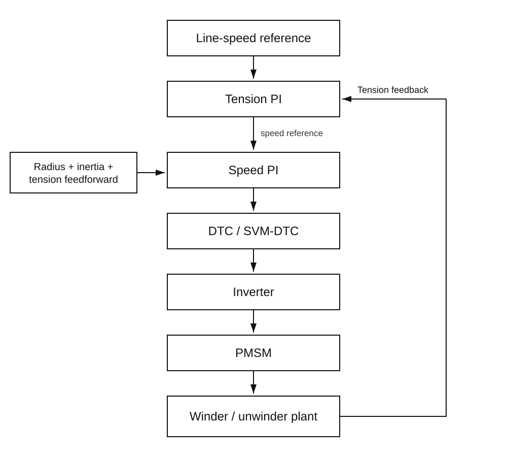
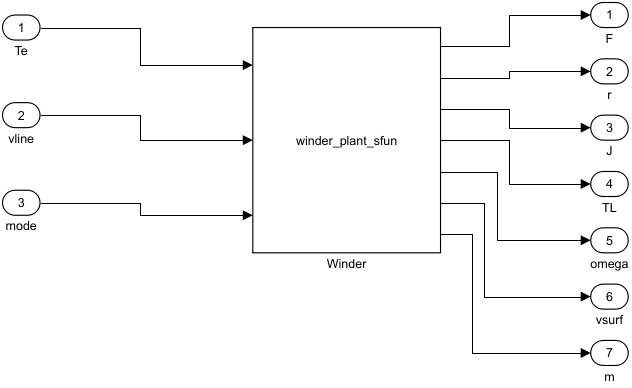
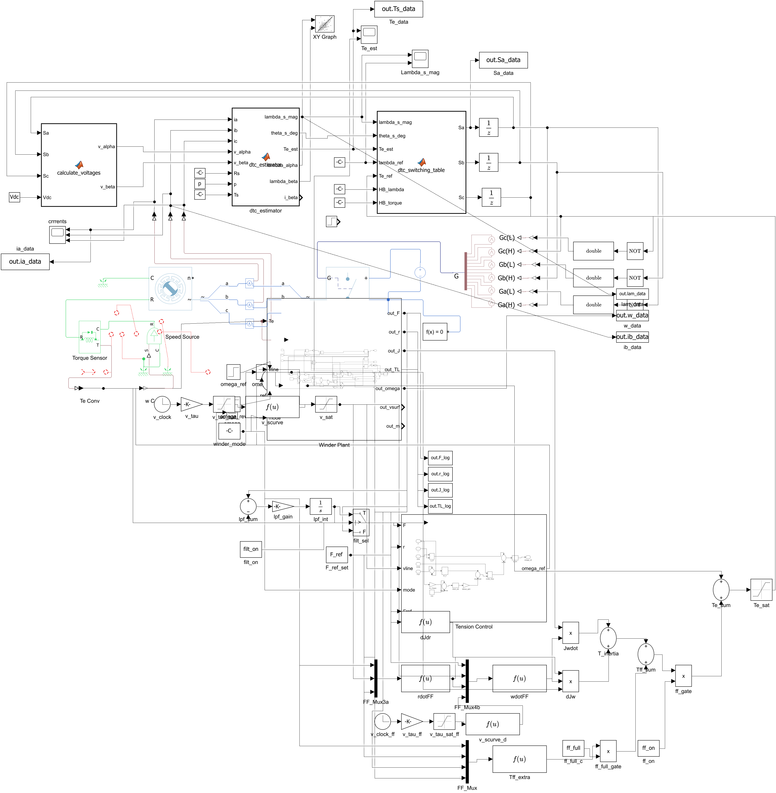
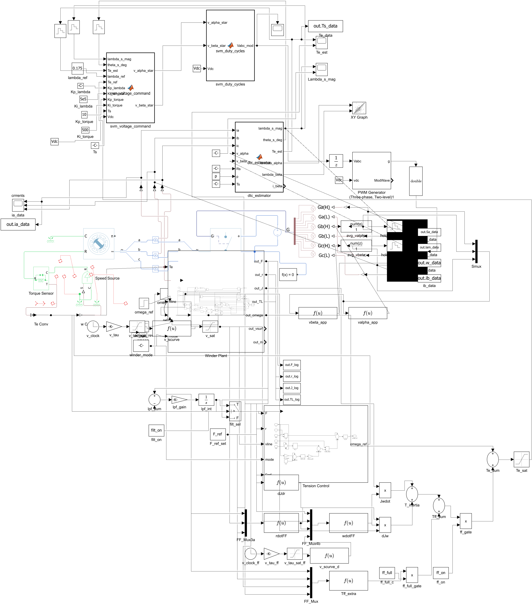
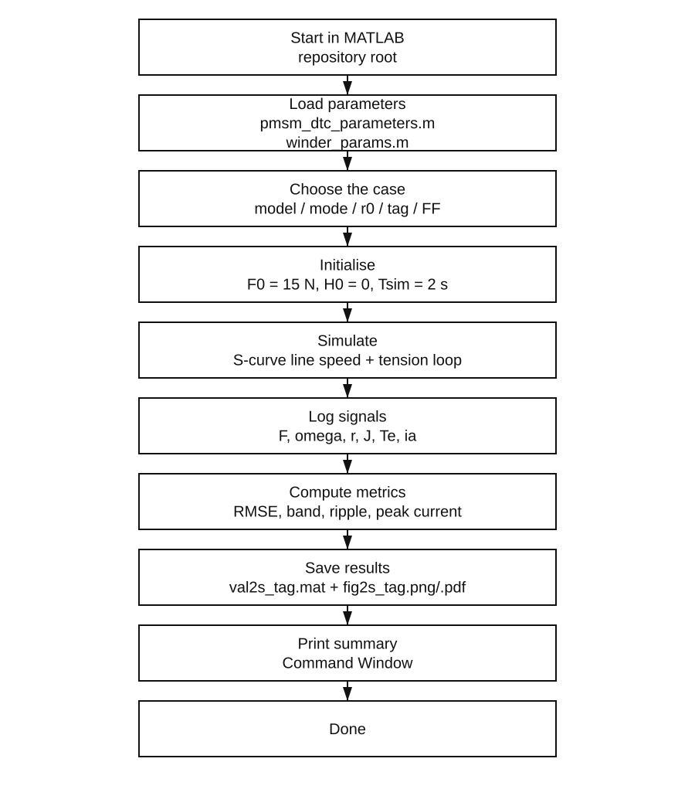
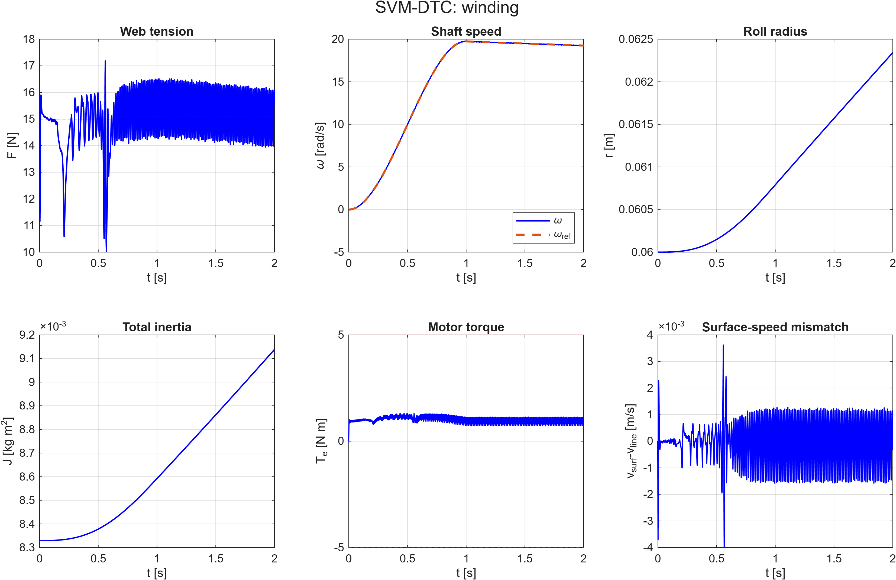

# Winder Tension Control with a PMSM Drive

**Experiment 05.** Classical DTC versus SVM-DTC on a variable-radius winder.

This experiment examines tension control for a paper-like web wound onto a variable-radius roll. Roll radius and inertia vary continuously with the wound mass while web tension is held at 15 N. The bench combines the mechanical winder plant, the tension loop, a model-based feedforward, and a like-for-like comparison of two PMSM torque-control methods.

Feedforward reduces tension RMSE by 89–98 % relative to the same controller without feedforward. In winding, classical DTC with feedforward produces the tightest tension band; in unwinding, SVM-DTC with feedforward is tighter. SVM-DTC produces substantially lower torque ripple and draws less current.

## Overview

| Item | Detail |
|---|---|
| Controlled variable | Web tension at a 15 N setpoint |
| Actuator | Permanent-magnet synchronous motor (PMSM) |
| Plant variation | Roll radius and inertia change during the run — increasing when winding, decreasing when unwinding |
| Comparison | Classical DTC and SVM-DTC, each with feedforward off and on |
| Dominant effect | Speed and torque feedforward |
| Case duration | 2 s of simulated time with a 1 s line-speed ramp |

## Plant model

The plant comprises a roll (core plus wound material), a web (paper, film or foil), and a line that supplies or removes the web at a prescribed speed. In winding the roll radius grows; in unwinding it shrinks. In both directions the roll surface speed and the line speed must remain close, because tension is generated by their difference:

```text
dF/dt = mode · K · (v_surf − v_line)      K = E·A/L ≈ 3.0e5 N/m
```

A surface-speed mismatch of a fraction of a millimetre per second changes tension rapidly. Tension regulation is therefore primarily a speed-regulation problem.

| Tension | Consequence |
|---|---|
| Too low | Web goes slack, wrinkles, mistracks, and the roll winds loosely |
| Correct | Firm roll, no slip, consistent product |
| Too high | Web stretches or breaks; motor and bearing loads increase |

The final drive models use a Kelvin–Voigt web, for which tension is an algebraic function of web extension and extension rate:

```text
m(r)   = ρ·w·π·(r² − rc²)
J(r)   = Jm + Jc + ½·m·(r² + rc²)
dr/dt  = mode·h·v_line/(2πr)
dH/dt  = Te − mode·F·r − B·ω,        H = J·ω
ẋ      = mode·(v_surf − v_line)
F      = sat(K·x + C_web·ẋ, 0, Fmax),   K = E·A/L
```

The momentum form is used deliberately: the variable-inertia term is carried by the state equation,

```text
d(J·ω)/dt = J·dω/dt + ω·dJ/dt = Te − T_web − B·ω,
```

rather than added as an external load torque. In winding (`dJ/dt > 0`) it acts as additional drag; in unwinding (`dJ/dt < 0`) it acts as additional acceleration. The web torque is `T_web = mode·F·r`: it opposes the motor in winding, and drives the roll in unwinding while the motor brakes.

The final drive models (`models/svm_dtc_winder.slx`, `models/classic_dtc_winder.slx`) implement this Kelvin–Voigt plant natively with `C_web = 500 N·s/m`. `scripts/winder_plant_sfun.m` is a separate pure-spring implementation (`C_web = 0`) used only by the standalone pre-damping model `models/winder_mechanics.slx`; it is not the plant used for the results reported here.

## PMSM drive

The PMSM is the torque actuator. Tension is not commanded directly: the speed loop requests torque, and the inner DTC controller realizes that request through inverter switching.

Classical DTC selects an inverter state directly from the flux and torque errors using hysteresis bands and a switching table. SVM-DTC retains the flux/torque control structure but adds PI regulators and a space-vector modulator, so the inverter switches at a fixed frequency.

Two inner controllers are compared under identical mechanics:

| | Classical DTC | SVM-DTC |
|---|---|---|
| Switching | Hysteresis bands and switching table | Space-vector modulation at fixed frequency |
| Strong point | Simple, fast torque response | Smooth torque and current |
| Weak point | Higher ripple, variable switching | More tuning blocks (flux/torque PI) |
| Torque ripple here | ≈ 0.42 N·m | ≈ 0.02–0.07 N·m |
| Peak current here | ≈ 2.0–2.6 A | ≈ 1.2–1.9 A |

Both controllers use the same voltage-model stator-flux estimator (λ ≈ 0.175 Wb), the same 20 µs controller step, and the same 5 N·m torque limit. The core controller, estimator, and modulation blocks are carried over from `exp03` unchanged.

## Control architecture



*Figure 1. Tension loop, speed loop, PMSM drive, and winder plant.*

The architecture comprises three layers:

- **Tension loop (outer):** compares measured tension `F` with the 15 N reference. Its PI output is a small draw correction added to the roll speed. The sign depends on the mode: winding raises tension by speeding the roll up, unwinding raises tension by slowing it down.
- **Feedforward (parallel):** predicts the speed `v_line/r` and the torque required for inertia, the changing inertia `dJ/dt`, web tension, and friction. The PI loop then corrects only the residual.
- **Drive (inner):** the speed PI converts speed error into a torque command; classical DTC or SVM-DTC converts that command into inverter switching.

The line reference feeds both paths: it sets the baseline roll speed, and the tension PI trims it through the draw correction. The torque feedforward is

```text
T_ff = J·dω_ref/dt + (dJ/dt)·ω_ref + mode·F_ref·r + B·ω_ref
       └── inertia ──┘ └ changing inertia ┘ └─ web ─┘ └ friction ┘
```

## Model and test conditions

| Layer | Implementation | Location |
|---|---|---|
| Winder plant, final models | Native Kelvin–Voigt web; continuous states `r`, `H = Jω`, `x`; `C_web = 500 N·s/m` | `models/svm_dtc_winder.slx`, `models/classic_dtc_winder.slx` |
| Winder plant, standalone verification | Level-2 MATLAB S-function; pure-spring web; states `r`, `H`, `F` | `models/winder_mechanics.slx`, `scripts/winder_plant_sfun.m` |
| Drive | PMSM and 2-level inverter, 20 µs controller step, 5 N·m limit | `models/` (from `exp03`) |
| Estimator | Voltage-model stator flux from inverter voltage and current; λ ≈ 0.175 Wb, shared by both drives | `models/` (from `exp03`) |
| Controllers | Classical DTC or SVM-DTC, plus the speed PI | `models/*.slx` |
| Tension loop | PI, slack take-up, and 2 Hz feedback filter at a 15 N setpoint | `scripts/add_tension_control.m` |
| Feedforward | Speed `v_line/r` and torque (inertia, `dJ/dt`, web, friction) | `scripts/add_feedforward.m` |



*Figure 2. Standalone winder plant subsystem used for the pre-damping numerical verification. Inputs `Te`, `v_line`, `mode`; outputs `F`, `r`, `J`, `TL`, `omega`, `v_surf`, `m`.*

### Model variants

| File | Role | Execution status |
|---|---|---|
| `models/svm_dtc_winder.slx`, `models/classic_dtc_winder.slx` | Authoritative drive models with the native Kelvin–Voigt plant | Executed by `scripts/run_final_matrix.m`; source of all reported results |
| `models/*_clean.slx` | Readability and reference copies of the drive models | Not executed |
| `models/winder_mechanics.slx` | Standalone pre-damping verification model with the S-function pure-spring plant | Used only for the numerical verification in `TECHNICAL_NOTES.md` §6; not used for the final results |

### Test conditions

| Item | Value |
|---|---|
| Tension setpoint | 15 N |
| Simulated duration | 2 s |
| Line-speed ramp | 1 s |
| Line-speed reference | S-curve to 1.2 m/s nominal; 0.8 and 1.6 m/s in the robustness cases |
| Controller sample time | 20 µs |
| Solver maximum step | 5 µs |
| Torque limit | ±5 N·m |
| Web model | Kelvin–Voigt, `C_web = 500 N·s/m` |
| Analysis window for RMSE and ripple | 1.3–2.0 s |

The 18-case matrix comprises:

| Group | Cases |
|---|---|
| Four-way comparison | SVM/classical × feedforward off/on × winding/unwinding (8) |
| Line-speed robustness | 0.8 and 1.6 m/s, winding, both controllers, feedforward on (4) |
| Initial-radius robustness | Winding `r0 = 0.08 m`, unwinding `r0 = 0.10 m`, both controllers (4) |
| Tension-reference step | 15 → 18 N at 1.2 s, winding, both controllers (2) |
| Total | 18 |

### Whole-model screenshots



*Figure 3. Classical DTC winder top level.*



*Figure 4. SVM-DTC winder top level.*


*Figure 5. Winder plant subsystem.*

These are the complete top-level models: drive, estimator, controller, winder plant, tension loop, feedforward, and logging.

### Execution



*Figure 6. Sequence of operations in one 2 s case.*

A single 2 s case takes a few minutes because the solver maximum step is 5 µs.

## Results


*Figure 7. Left: tension RMSE with feedforward off and on. Right: torque ripple by controller.*

| Configuration | F RMSE | F range | Torque ripple | Current peak |
|---|---:|---:|---:|---:|
| SVM wind, FF off | 7.153 N | 0.00-23.43 N | 0.074 N·m | 1.47 A |
| SVM wind, FF on | 0.794 N | 10.03-17.19 N | 0.072 N·m | 1.22 A |
| Classical wind, FF off | 7.302 N | 0.00-23.29 N | 0.421 N·m | 2.25 A |
| Classical wind, FF on | 0.319 N | 13.98-16.21 N | 0.418 N·m | 1.98 A |
| SVM unwind, FF on | 0.052 N | 8.82-17.39 N | 0.019 N·m | 1.72 A |
| Classical unwind, FF on | 0.114 N | 12.91-16.04 N | 0.414 N·m | 2.57 A |

*F RMSE and ripple use 1.3–2.0 s; range and peak current use the full run. All cases: 15 N setpoint, 2 s, no torque saturation.*

Four observations follow from the table:

- Feedforward is the dominant improvement: **89–98 % lower tension RMSE** and no startup slack.
- Classical DTC with feedforward gives the tightest tension band, but with 5–20× more torque ripple and higher peak current.
- SVM-DTC with feedforward is the smoothest option and draws the least current. Its winding case still has brief dips to approximately 10 N; they are bounded, not eliminated.
- Unwinding benefits most: SVM reaches **0.052 N** RMSE with only 0.019 N·m ripple.

The full 18-case matrix, including speed and radius robustness and a tension step, is in `results/final_matrix.csv`.

### Representative responses



*Figure 8. SVM-DTC, winding, feedforward on.*


*Figure 9. Classical DTC, winding, feedforward on.*

Both panels show tension, shaft speed, roll radius, inertia, motor torque, and surface-speed mismatch. The classical drive holds a tighter tension band but shows visibly larger torque ripple. The SVM drive has lower torque and current ripple, with short tension dips during the ramp.

## Reproducing a case

From the repository root, in MATLAB with Simulink and Simscape:

```matlab
cd('experiments/exp05_winder_mechanics')
addpath(fullfile(pwd,'models'), fullfile(pwd,'scripts'), fullfile(pwd,'..','..','tools'))
run('..\exp03_rs_boundary\scripts\pmsm_dtc_parameters.m')
run('scripts\winder_params.m')
met = run_case_2s('classic_dtc_winder', +1, 0.06, 'my_test', 1, 1);
```

| Argument | Example | Meaning |
|---|---|---|
| `model` | `'classic_dtc_winder'` | or `'svm_dtc_winder'` |
| `mode` | `+1` | `+1` winding, `−1` unwinding |
| `r0` | `0.06` | initial radius, m (`0.06` wind / `0.115` unwind) |
| `tag` | `'my_test'` | suffix for the output files |
| `ffon` | `1` | `0` feedforward off, `1` on |
| `fffull` | `1` | `1` full feedforward, `0` inertia-only |

The function sets `Tsim = 2 s`, `T_ramp = 1 s`, enables the 2 Hz tension filter, and uses `MaxStep = 5e-6`. To reproduce all 18 cases, run `scripts/run_final_matrix.m`.

## Outputs

| Output | Path | Contents |
|---|---|---|
| Data | `results/val2s_<tag>.mat` | `t`, `F`, `omg`, `wr`, `vl`, `r`, `J`, `TL`, `Te`, `ia`, `met` |
| Figure | `figures/fig_case_<tag>.png` | Six-panel summary at 300 dpi |
| Vector figure | `figures/fig_case_<tag>.pdf` | Same figure for reports |
| Editable figure | `figures/fig_case_<tag>.fig` | MATLAB figure file |
| Console | Command Window | Printed metric summary |

The printed summary contains tension RMSE, min/max/mean tension, speed RMSE, torque ripple, peak and RMS current, saturation time, torque-balance residual, and wall-clock time.

Figure filenames use the `fig_case_` prefix. The tag is lowercased and periods are removed before it is appended, so `SVM_wind_v0.8_ff1` becomes `fig_case_svm_wind_v08_ff1`.

## Limitations

- The mechanical parameters are illustrative, not measured material data. `C_web` is physically motivated but not measured.
- This is a simulation study with one web material and a taut-web model; no experimental validation is available.
- The SVM winding dips near 0.1, 0.2, and 0.58 s remain a known limitation of this plant/controller pairing. They are bounded transients, not sustained slack.
- Classical DTC's higher ripple is inherent to hysteresis switching, not a tuning error.
- The model omits transport delay, web mass, roller eccentricity, air entrainment, wound-in tension, and motor iron loss, saturation, and thermal effects.

## References

- Takahashi, I., & Noguchi, T. (1986). A new quick-response and high-efficiency control strategy of an induction motor. *IEEE Transactions on Industry Applications*, IA-22(5), 820–827.
- Depenbrock, M. (1988). Direct self-control (DSC) of inverter-fed induction machine. *IEEE Transactions on Power Electronics*, 3(4), 420–429.
- Zhong, L., Rahman, M. F., Hu, W. Y., & Lim, K. W. (1997). Analysis of direct torque control in permanent magnet synchronous motor drives. *IEEE Transactions on Power Electronics*, 12(3), 528–536.
- Hu, J., & Wu, B. (1998). New integration algorithms for estimating motor flux over a wide speed range. *IEEE Transactions on Power Electronics*, 13(5), 969–977.
- Haque, M. E., & Rahman, M. F. (2000). A PI stator resistance compensator for a direct torque controlled interior permanent magnet synchronous motor drive. *Proceedings of the IEEE International Power Electronics and Motion Control Conference (IPEMC)*.
- Koc, H., Knittel, D., de Mathelin, M., & Abba, G. (2002). Modeling and robust control of winding systems for elastic webs. *IEEE Transactions on Control Systems Technology*, 10(2), 197–208.
- Buja, G. S., & Kazmierkowski, M. P. (2004). Direct torque control of PWM inverter-fed AC motors — a survey. *IEEE Transactions on Industrial Electronics*, 51(4), 744–757.
- Kadjoudj, M., Golea, N., & Benbouzid, M. E. H. (2007). Problems of stator flux estimation in DTC of PMSM drives. *Journal of Electrical Engineering and Technology*, 2(4), 468–477.
- Pagilla, P. R., Siraskar, N. B., & Dwivedula, R. V. (2007). Decentralized control of web processing lines. *IEEE Transactions on Control Systems Technology*, 15(1), 106–117.

Detailed derivations, intermediate experiments, and acceptance checks are documented in [TECHNICAL_NOTES.md](TECHNICAL_NOTES.md). The consolidated write-up is [reports/final_2026-11/main.pdf](../../reports/final_2026-11/main.pdf); environment setup and full-matrix execution are described in [docs/RUNBOOK.md](../../docs/RUNBOOK.md).
